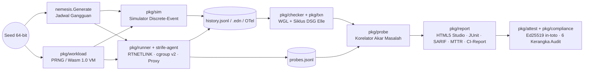

# Strife

**Injeksi gangguan deterministik, verifikasi linearizability, dan deteksi anomali transaksional untuk sistem terdistribusi.**

[](https://github.com/Kemalhafizh/strife/actions/workflows/ci.yml)
[](https://github.com/Kemalhafizh/strife/actions/workflows/live.yml)
[](go.mod)
[-2ea44f)](go.mod)
[](LICENSE)

**Bahasa:** [English](README.md) · Bahasa Indonesia

[Mulai Cepat](#mulai-cepat) · [Situs & Playground](https://kemalhafizh.github.io/strife/) · [Memperkecil Kegagalan](#memperkecil-kegagalan) · [Model & Checker](#model-konsistensi--deteksi-anomali) · [Cluster Sungguhan & Agent](#cluster-sungguhan--strife-agent) · [Tolok Ukur](docs/id/BENCHMARKS.md) · [Beban Kerja Wasm](#beban-kerja-kustom--vm-wasm) · [Kampanye Regresi](#kampanye-regresi) · [Atestasi & Kepatuhan](#atestasi-kriptografis--dossier-kepatuhan) · [Registri Run](#registri-run-strife-serve) · [Arsitektur](#arsitektur) · [Tata Kelola](docs/id/GOVERNANCE.md)

---

Strife menjalankan beban kerja konkuren terhadap cluster simulasi maupun cluster sungguhan sambil menyuntikkan partisi jaringan, perlambatan dan kehilangan paket, penghentian proses mendadak (`SIGKILL`), penjeda proses (`SIGSTOP`), pembekuan cgroup v2, kemacetan I/O blok, dan pergeseran jam. Setiap pemanggilan (*invocation*) dan penyelesaian (*completion*) klien direkam ke dalam riwayat bergaya Jepsen, lalu Strife membuktikan secara formal apakah eksekusi tersebut memenuhi linearizability atau isolasi transaksi.

Setiap eksekusi dikendalikan oleh satu seed 64-bit. Pada cluster sungguhan, seed menentukan jadwal gangguan serta aliran operasi tiap klien. Di dalam simulator *discrete-event* bawaan, seed menentukan seluruh jalannya eksekusi—urutan pengiriman paket jaringan, pemicuan timer, penulisan disk (`flush`), dan pergeseran jam—sehingga dapat diputar ulang secara identik bit demi bit dengan digest jejak SHA-256 yang dapat diverifikasi.

```console
$ strife sim --system raft-unsafe-fsync --faults kill,io-stall --seed 13
system:  raft-unsafe-fsync   seed: 13   nodes: 5   simulated: 10s   events: 108793   wall: 521ms
faults:  6 scheduled (schedule 935d69e22cc1a0f3)
           1.056s →   2.127s  kill [0 2]
           2.668s →   4.069s  io-stall [3]
           4.070s →   6.177s  kill [1]
           4.714s →   5.654s  io-stall [0 1 3]
           6.507s →   8.500s  io-stall [0 1 2 3 4]
           7.878s →   8.500s  kill [0 1 2 3 4]
ops:     4429 (3717 ok, 692 fail, 20 info)   history 66a5f95de89d72c8   trace 50173cb8d89db240
verdict: VIOLATION
  key k0: No linearization places "p29 read k0 → 3" before it returned. After the longest
  valid prefix (854 ops) the model state is 1, and none of the 2 concurrent candidates can
  be applied first to reach a state that explains it.
```

Pada jejak di atas, sebuah implementasi Raft mengakui penambahan log sebelum `fsync` benar-benar tuntas ke disk. Ketika seluruh kelima disk mengalami kemacetan I/O pada `6.507s` dan cluster kehilangan daya secara serentak pada `7.878s`, data penulisan yang sudah dikonfirmasi berhasil lenyap setelah pemulihan. Karena sepuluh detik simulasi dieksekusi hanya dalam ~520 ms waktu nyata, satu komputer kerja dapat menyapu ribuan jadwal gangguan dalam beberapa menit.

---

## Batasan Desain

- **Nol dependensi eksternal.** Baik `strife` maupun `strife-agent` dikompilasi murni dari pustaka standar Go 1.23 (`go.mod` tidak memiliki blok `require`). Protokol jaringan untuk etcd v3, Redis/Valkey (RESP2), PostgreSQL (protokol v3 dengan SCRAM-SHA-256 dan TLS), MySQL/TiDB (`caching_sha2_password`, TLS), Kafka (Produce v3 / Fetch v4, RecordBatch v2 dengan CRC-32C), soket rute `AF_NETLINK` Linux, penandatanganan Ed25519 `in-toto`, serta interpreter bytecode WebAssembly 1.0 seluruhnya diimplementasikan langsung di dalam repositori.
- **Keacakan yang dipatok (*pinned randomness*).** Algoritma `math/rand` standar tidak dijamin tetap identik di setiap rilis Go. Strife memakai PRNG mandiri `xoshiro256**` yang di-seed melalui `SplitMix64` ([`internal/rng`](internal/rng/rng.go)) dengan percabangan aliran per aktor berbasis FNV-1a (`root.Fork("client/3")`), sehingga menambah klien atau node tidak mengganggu urutan bilangan acak aktor lain.
- **Verdict yang jujur.** Bila pemeriksa (*checker*) kehabisan anggaran langkah atau batas waktu tanpa menemukan linearisasi yang sah maupun bukti ketidakmungkinan, verdict-nya adalah `unknown` (kode keluar `3`), tidak pernah `linearizable` palsu. Eksekusi langsung (*live run*) tanpa satu pun operasi yang berhasil juga bernilai `unknown`. Checker transaksional *sound-incomplete* (`append`, `ledger`, `settlement`) juga mengembalikan `unknown` (`sound incomplete`) bila tidak ditemukan anomali di luar pencarian tuntas berbatas (`<= 16` operasi, `<= 4` operasi `info`, `<= 500.000` langkah pada `strict-serializable`); gunakan `--expect no-anomaly` di CI untuk memvalidasi nol anomali terdeteksi.
- **Klaim terukur.** Setiap angka performa atau deteksi di berkas ini merujuk ke [`docs/id/BENCHMARKS.md`](docs/id/BENCHMARKS.md), yang mencantumkan perintah, mesin, dan tanggal pengukurannya.

---

## Mulai Cepat

Pasang biner rilis (tersedia arsip untuk Linux, macOS, dan Windows lengkap dengan `SHA256SUMS`, SBOM SPDX, dan—bila kunci rilis terkonfigurasi—atestasi `in-toto` yang ditandatangani dengan penandatanganan Ed25519 milik Strife), gunakan image kontainer, atau bangun dari kode sumber:

```sh
# Biner rilis: https://github.com/Kemalhafizh/strife/releases
sha256sum -c --ignore-missing SHA256SUMS
strife verify --bundle strife_v1.0.0.intoto.json --key release.pub --release-dir .

# Image kontainer (linux/amd64, linux/arm64)
docker run --rm ghcr.io/kemalhafizh/strife:latest version
docker run --rm ghcr.io/kemalhafizh/strife-agent:latest -h

# Dari kode sumber (Go 1.23+, tanpa CGo, tanpa dependensi)
go build -o strife ./cmd/strife
```

```sh

# Tampilkan daftar implementasi konsensus simulasi bawaan
strife systems

# Jalankan satu seed Raft yang benar di bawah kedelapan jenis gangguan
strife sim --system raft --seed 7

# Sapu 100 seed terhadap varian Raft yang melayani pembacaan lokal leader tanpa putaran kuorum
strife sim --system raft-stale-reads --faults partition --seeds 1..100

# Verifikasi determinisme simulator bit demi bit di 500 seed dalam CI dengan gerbang SLO
strife sim --system raft --seeds 1..500 --determinism --expect linearizable \
  --max-mttr 500ms --min-availability 0.95
```

Setiap eksekusi yang menemukan pelanggaran menulis direktori artefak mandiri (`strife-out/<system>-seed<N>/`) berisi:

| Artefak | Kegunaan |
| :--- | :--- |
| `report.html` | Studio timeline HTML5/Canvas luring (*offline*) dengan *pan/zoom* 60fps, fokus anomali otomatis, filter kunci/proses, inspektor operasi, dan fallback SVG `<noscript>` |
| `report.md` | Ringkasan Markdown yang cocok untuk *pull request* dan `$GITHUB_STEP_SUMMARY` |
| `report.json` | Verdict terbaca mesin, saksi contoh tandingan (*counterexample*), analisis akar masalah, metrik MTTR/ketersediaan pasca-pemulihan, dan sidik jari SHA-256 |
| `history.jsonl` | Log operasi lengkap (`invoke`, `ok`, `fail`, `info`) berstempel waktu nanodetik |
| `schedule.json` | Jadwal gangguan yang dapat diputar ulang (`strife sim --plan schedule.json`) |

---

## Memperkecil Kegagalan

Pelanggaran mentah kerap mencakup ribuan operasi dan setengah lusin gangguan yang saling bertumpuk. `strife shrink` mereduksi skenario simulasi maupun riwayat terekam menjadi contoh tandingan **1-minimal** (menghapus satu gangguan atau operasi apa pun yang tersisa akan menghilangkan pelanggarannya), serta mereduksi jadwal gangguan cluster sungguhan menjadi pereproduksi **kandidat** minimal lengkap dengan tingkat reproduksi terukur.

### 1. Pengecilan Skenario (`strife shrink`)

Delta debugging (`ddmin`) berjalan melintasi sembilan tahap deterministik: durasi uji, himpunan gangguan, target node gangguan, jendela mulai/berakhir gangguan, pembulatan waktu ke kisi (`100ms` → `10ms` → `1ms`), magnitudo gangguan, jumlah klien, tahap durasi kedua, dan pemeriksaan akhir 1-minimalitas.

```console
$ strife shrink --system raft-unsafe-fsync --faults kill,io-stall --seed 13
shrinking raft-unsafe-fsync seed 13…
  baseline    1 runs  faults 6   10s       clients 10  6 faults, 4429 ops
  duration   18 runs  faults 6   8.94s     clients 10  10s → 8.94s
  faults     27 runs  faults 2   8.94s     clients 10  ddmin: 6 → 2 faults
  targets    46 runs  faults 2   8.94s     clients 10  removed 4 fault targets
  windows    86 runs  faults 2   8.94s     clients 10  total fault time now 1.52s
  round      98 runs  faults 2   8.94s     clients 10  snapped 3 fault boundaries to a coarse grid; 1 timing-critical boundaries kept exact
  verify    126 runs  faults 2   8.39s     clients 10  1-minimal: every remaining fault [4 5] is necessary
minimal: 6 → 2 faults, 10s → 8.39s, 10 → 10 clients, 4429 → 3931 ops (127 runs, 18s)
         #4   6.5s          → 7.9s          io-stall [3]
         #5   7.877832081s  → 8.1s          kill [0 1 2 3 4]
```

Perhatikan `#5`: stempel waktu `kill` (`7.877832081s`) tetap dipertahankan eksak karena membulatkannya ke kisi kasar justru membiarkan `fsync` yang tertahan di node 3 selesai sebelum mati daya. Pada korpus tolok ukur di [`docs/id/ROADMAP.md`](docs/id/ROADMAP.md), **35 dari 37 seed yang melanggar (95%)** berhasil direduksi menjadi $\le 3$ gangguan dalam 80–150 eksekusi simulator.

### 2. Pengecilan Riwayat (`strife shrink --history`)

Untuk jejak cluster sungguhan di mana mengulang eksekusi bersifat probabilistik, `strife shrink --history` mereduksi berkas `history.jsonl` secara luring:

```console
$ strife shrink --history ops.jsonl --model kv --out strife-out/
shrinking history "ops.jsonl" (2400 ops, model kv)…
  partition    150 ops   isolated violating key "k0"
  diagnose     3 ops     found sound register witness
  ddmin-read   3 ops     eliminated non-essential reads
  ddmin-sound  3 ops     preserved causal write history (isSoundHistory invariant)
  verify       3 ops     1-minimal: dropping any remaining operation removes violation
minimal: 2400 → 3 ops (0.04s)
         #1  call 0.001s   return 0.005s   p1 write k0 → 2
         #2  call 0.006s   return 0.008s   p2 write k0 → 3
         #3  call 0.009s   return 0.012s   p3 read k0 → 2
diagnosis: stale read: p3 read 2 returned at 0.012s, but p2 write 3 completed earlier at 0.008s (1.000ms before read call)
```

> [!IMPORTANT]
> Pemangkasan operasi secara naif dapat menghapus penulisan yang menghasilkan nilai yang dibaca belakangan, sehingga menciptakan pelanggaran palsu berupa "nilai tak pernah ditulis". `pkg/shrink` menegakkan invarian `isSoundHistory`: operasi tulis (termasuk operasi `info`) yang memasok nilai bagi pembacaan yang dipertahankan tidak boleh dihapus kecuali pembacaan bergantungnya dihapus lebih dahulu.

### 3. Pengecilan Jadwal Cluster Sungguhan (`strife shrink --live`)

Cluster sungguhan tidak bersifat deterministik: jadwal yang sama bisa memicu atau tidak memicu bug. `strife shrink --live` mengulang jadwal gangguan kandidat di cluster nyata dengan delta debugging, menandai kandidat gagal apabila salah satu dari `--attempts` percobaan melanggar, lalu mengulang jadwal minimal sebanyak `--verify` kali dan melaporkan tingkat reproduksinya. Hasilnya dilabeli sebagai *kandidat* (*candidate*), bukan pembuktian minimalitas.

```console
$ strife shrink --live --config examples/postgres/strife-replicas.json --duration 12s --attempts 2 --verify 3
shrinking 1 faults of "postgres-replicas" live (2 attempts per candidate, budget 40 runs)…
  run 1: 1 faults [0] → violation
  run 2: 0 faults [] → violation
  the violation occurs without any fault: the faults are not needed to reproduce it
  verify 1/3: violation
  verify 2/3: violation
  verify 3/3: violation
candidate: 1 → 0 faults, reproduced 3/3 (100%) in 2 live runs, 89.1s
replay: strife run --config examples/postgres/strife-replicas.json --schedule strife-out/postgres-replicas-live-min-…/schedule.json
```

Di sini pembacaan basi (*stale read*) dari standby asinkron PostgreSQL tidak memerlukan gangguan apa pun, dan itulah informasi yang krusial: masalahnya ada pada topologi, bukan pada partisi jaringan. `strife run --schedule FILE` memutar ulang jadwal terekam maupun hasil pengecilan.

---

## Model Konsistensi & Deteksi Anomali

`strife check` memverifikasi rekaman riwayat **Strife JSONL (`.jsonl`)**, **Jepsen EDN (`.edn`)**, maupun **OpenTelemetry Span JSON (ekspor JSON OTLP/HTTP `ExportTraceServiceRequest` & kolektor Jaeger)** terhadap sembilan model bawaan (serta `--export-edn` mengekspor riwayat yang telah diparsing menjadi format kanonik Jepsen EDN):

```sh
strife check --history ops.jsonl --model kv --out report/
strife check --history txn.jsonl --model txn --isolation snapshot-isolation
strife check --history ledger.jsonl --model ledger --out report/
strife check --history settlement.edn --model settlement --out report/
strife check --history otlp-traces.json --model kv --max-mttr 500ms --min-availability 0.99
```

| Model | Operasi | Mesin Verifikasi & Kompleksitas |
| :--- | :--- | :--- |
| `kv` | `read`, `write`, `cas` | Pencarian linearizability Wing & Gong / Lowe dengan memoisasi bitset status, pemangkasan celah mati interval nilai (`kvPruner`), P-komposisionalitas per kunci, reduksi simetri, serta diagnosis pembacaan basi $O(N \log N)$ (~18,7k–508k ops/dtk per inti pada satu kunci hingga 50 proses konkuren; [terukur](docs/id/BENCHMARKS.md#2-throughput-checker); jalur cepat diuji silang lewat `TestDifferentialOptimizerEquivalence`). |
| `set` | `add`, `read` | Linearizability set hanya-tumbuh + ekstraksi saksi elemen hilang. |
| `queue` | `enqueue`, `dequeue` | Linearizability antrean FIFO; mendiagnosis *phantom dequeue*, pembalikan urutan FIFO, dan pengembalian kosong prematur. |
| `counter` | `inc` / `add`, `read` | Linearizability penghitung bilangan bulat bersama; mendiagnosis kehilangan inkremen dan pembacaan berlebih. |
| `idgen` | `generate` | Verifikasi ID unik monoton/bebas kolisi dengan ekstraksi saksi duplikat. |
| `txn` | `txn` (`[r(k), w(k,v), ...]`) | Pembangunan Direct Serialization Graph (DSG) (`wr`, `ww`, `rw`, `so`, `ro`) + ekstraksi siklus terpendek Tarjan SCC di 6 level isolasi. |
| `append` | `txn` berisi `append(k, v)` / `r(k) → [v…]` | List-append bergaya Elle: urutan versi dipulihkan dari hasil baca, sisi `ww`/`wr`/`rw` dan waktu nyata, append hilang, urutan tak cocok, duplikat, dan pemeriksaan konsistensi internal (~40k–57k txn/dtk; 0 positif palsu dan 99,81% riwayat cacat tertangkap dalam uji silang brute-force, [terukur](docs/id/BENCHMARKS.md#3-ketepatan-checker)); memakai pencarian WGL tuntas berbatas pada `strict-serializable` berukuran kecil, selainnya `unknown (sound incomplete)`. |
| `ledger` | `txn` transfer akun & audit saldo | Pemeriksa buku besar keuangan berpasangan (*double-entry*) & konservasi uang (`LEDGER-CONSERVATION` $\sum B_i = M_0$, `LEDGER-OVERDRAFT` $B_i < 0$ & *write skew* `G2-item` konkuren, `LEDGER-DOUBLE-SPEND` pada pengulangan timeout `info`, serta `LEDGER-UNBALANCED` $\sum \Delta_k \ne 0$). |
| `settlement` | `txn` append buku besar/broker & pembacaan rekonsiliasi | Verifikasi kliring lintas-sistem & transaksional outbox (`SETTLEMENT-ATOMICITY`, `SETTLEMENT-NO-ORPHAN-CREDIT`, dan `SETTLEMENT-IDEMPOTENCY`). |

### Level Isolasi Transaksional & Klasifikasi Anomali Adya (`--model txn`)

Pemeriksa transaksional ([`pkg/txn`](pkg/txn/txn.go)) merekonstruksi versi item dari mikro-operasi tulis lalu memeriksa fenomena terlarang menurut definisi Adya (1999):

- **`G0` (Dirty Write):** Siklus yang hanya terdiri atas sisi kebergantungan tulis-tulis (`ww`).
- **`G1a` (Aborted Read):** Transaksi yang di-commit membaca nilai yang ditulis oleh transaksi yang batal/gagal.
- **`G1b` (Intermediate Read):** Transaksi yang di-commit membaca penulisan antara non-final dari transaksi lain.
- **`G1c` (Circular Information Flow):** Siklus berarah berisi sisi `wr` dan `ww` (dilarang oleh `read-committed` dan yang lebih kuat).
- **`G2-item` / `G2` (Anti-Dependency Cycles):** Siklus yang memuat satu atau lebih sisi anti-kebergantungan baca-tulis (`rw`), seperti Write Skew (`T1` membaca `x`, `T2` membaca `y`, `T1` menulis `y`, `T2` menulis `x`).
- **`G-realtime` (Real-Time Inversion):** Urutan serialisasi bertentangan dengan urutan penyelesaian waktu nyata (`ro`), melanggar `strict-serializable`.

Opsi `--isolation` yang didukung (berlaku untuk `--model txn`, `append`, dan `ledger`): `read-uncommitted`, `read-committed`, `repeatable-read`, `snapshot-isolation`, `serializable`, `strict-serializable`.

> [!NOTE]
> Prosedur keputusan graf kebergantungan untuk `append`, `ledger`, dan `settlement` bersifat **sound tetapi tidak lengkap** (*sound incomplete*). Bila tidak ada anomali yang ditemukan, Strife memverifikasi riwayat `strict-serializable` kecil (`<= 16` operasi dan `<= 4` operasi `info`, hingga `500.000` langkah) dengan pencarian WGL tuntas berbatas (`linearizable` hanya bila pencarian benar-benar tuntas), lalu mengembalikan `unknown` (`sound incomplete`) bila melampaui batas. Gunakan `--expect no-anomaly` di CI bila Anda ingin memastikan nol anomali terdeteksi tanpa mengklaim pembuktian formal menyeluruh.

---

## Cluster Sungguhan & `strife-agent`

`strife run` menggerakkan cluster nyata dari berkas konfigurasi JSON: seed menetapkan jadwal gangguan serta aliran operasi tiap klien, cluster menentukan penyisipan eksekusinya (*interleaving*), dan riwayat yang terekam diperiksa persis seperti hasil simulasi.

```sh
strife doctor --config strife.json        # periksa kapabilitas host dan uji keterjangkauan endpoint cluster
strife plan   --config strife.json        # cetak jadwal dan perintah eksak tanpa mengubah apa pun
strife run    --config strife.json        # jalankan, periksa, dan tulis report.html / report.json
strife run    --config strife.json --faults none --expect linearizable   # baseline bebas gangguan untuk CI
```

**Transport** (`transport.type`) menentukan cara perintah gangguan dikirim ke node:

| Transport | Mekanisme | Gangguan host (`freeze`, `io-stall`) |
| :--- | :--- | :--- |
| `proxy` | Proxy gangguan L4 TCP ruang pengguna (*user-space*) bawaan untuk Linux, macOS, dan Windows (tanpa hak root atau modul kernel) | ya (lewat penghentian aliran TCP) |
| `docker` | `docker exec` per perintah; perintah host berjalan di Docker host (opsional `sudo -n`). `"cgroup": "auto"` dan `"io_device": "auto"` ditemukan otomatis saat berjalan. | ya |
| `ssh` | perintah `ssh` sistem (memakai key, agent, jump host, dan `known_hosts` sesuai konfigurasi), opsional `sudo -n` | ya |
| `kubernetes` | `kubectl exec` ke dalam pod; `"ip": "auto"` membaca IP pod saat eksekusi dan endpoint `{ip}` diperluas per node ([contoh](docs/id/examples/kubernetes/README.md)) | tidak: gunakan agen |
| `agent` | `strife-agent` di tiap node: HTTP persisten, netlink untuk netem, sinyal langsung dan cgroup v2, autentikasi token | ya |
| `dry-run` | hanya mencatat perintah | – |

**Klien** (`db.kind`) diimplementasikan langsung di repositori, dengan kredensial ditulis sebagai rujukan `env:NAMA` atau `file:PATH` agar rahasia tidak pernah masuk ke konfigurasi maupun laporan:

| Target | Protokol dan autentikasi | Beban kerja | Klasifikasi hasil |
| :--- | :--- | :--- | :--- |
| `etcd` | gateway JSON v3 | `kv` (baca, tulis, compare-and-swap), `append`, `ledger` (transaksi optimistik dijaga `mod_revision`), `settlement` | ditolak → `fail`; timeout setelah kirim → `info` |
| `redis` / `valkey` | RESP2, `AUTH`, TLS | `kv` (Lua CAS atomik), `append`, `ledger` (skrip Lua per transaksi), `settlement` | `-READONLY` / `-ERR` → `fail`; galat I/O setelah kirim → `info` |
| `postgres` | protokol v3, SCRAM-SHA-256 / MD5, TLS (`require`, `verify-full`) | `kv`, `append`, `ledger`, `settlement` di sembarang `txn_isolation` | `40001`, `40P01`, `25006`… → `fail`; koneksi putus setelah `COMMIT` → `info` |
| `mysql` / `tidb` | `caching_sha2_password` (jalur cepat, RSA atau TLS penuh), `mysql_native_password`, TLS, `init_sql` | `kv`, `append`, `ledger`, `settlement` | deadlock / lock timeout / konflik tulis TiDB → `fail`; putus setelah `COMMIT` → `info` |
| `kafka` | ApiVersions, Metadata v4, Produce v3 (`acks=all`), Fetch v4, RecordBatch v2 | `append` (tiap kunci berupa topik partisi tunggal, dibaca dari offset 0) | ditolak sebelum append (bukan leader, replika kurang…) → `fail`; timeout/putus setelah kirim → `info` |

`workload.model` memilih `kv` (linearizability), `append` (transaksi list-append diperiksa pada `workload.isolation`, dari `read-uncommitted` hingga `strict-serializable`), `ledger` (transfer keuangan berpasangan dan audit saldo multi-akun memeriksa konservasi uang, non-negativitas, dan anomali isolasi pada `workload.isolation`), atau `settlement` (rekonsiliasi kliring dua-kaki lintas-sistem & transaksional outbox memeriksa `SETTLEMENT-ATOMICITY`, `SETTLEMENT-NO-ORPHAN-CREDIT`, dan `SETTLEMENT-IDEMPOTENCY`). `db.txn_isolation` menetapkan level tempat database berjalan, sehingga Anda dapat, misalnya, menjalankan PostgreSQL di `REPEATABLE READ` dan mengujinya terhadap kontrak `serializable`. Baik `strife check` maupun `strife shrink --history` otomatis menerima berkas riwayat `.jsonl` native dan ekspor `.edn` Jepsen.

> [!NOTE]
> Setiap kali klien mencatat `info` (misalnya koneksi TCP terputus setelah mengirim `SET` atau `COMMIT`), operasi tersebut tetap mungkin terlaksana di server pada titik waktu mana pun berikutnya. Mengikuti invarian proses Jepsen, *worker* menutup soket dan menaikkan ID logis `process` (`process += concurrency`) sebelum mengirim operasi baru.

### Latensi Injeksi: `docker exec` vs `strife-agent`

`strife bench inject` mengukur seberapa lambat tiap gangguan benar-benar mendarat setelah waktu rencananya. Pada runner GitHub terhadap cluster etcd 3-node (50 transisi per baris, [tabel dan metode lengkap](docs/id/BENCHMARKS.md#1-latensi-injeksi-gangguan)):

| Gangguan | `docker exec` P50 / P95 | `strife-agent` P50 / P95 | Di dalam agen (P50) |
| :--- | ---: | ---: | ---: |
| `pause` (SIGSTOP) | 43,7 / 45,1 ms | **1,36 / 1,90 ms** | 372 µs |
| `kill` (SIGKILL) | 44,4 / 46,1 ms | **1,58 / 1,99 ms** | 495 µs |
| `partition` (iptables) | 57,9 / 61,3 ms | **4,02 / 4,29 ms** | 2,61 ms |
| `latency` (netem) | 42,8 / 44,1 ms | 48,1 / 59,5 ms ¹ | **159 µs** |

¹ Balasan dari agen melewati antarmuka jaringan yang baru saja diperlambat, sehingga konfirmasinya tiba terlambat; qdisc sendiri terpasang 159 µs setelah permintaan diterima agen. Pada run `39039844498` partisi masih memakai fallback `iptables`; kini `strife-agent` menggunakan aturan blackhole FIB `AF_NETLINK` (`RTM_NEWRULE` / `FR_ACT_BLACKHOLE`) bila *policy routing* kernel diizinkan, dengan fallback otomatis ke `iptables`. Sinyal, netem, dan penulisan cgroup berupa *syscall* langsung.

### Probe Diagnostik Sisi Server & Korelasi Akar Masalah

Sementara riwayat klien membuktikan *apakah* pelanggaran konsistensi terjadi, `strife-agent` juga menyediakan `GET /probes` ([`pkg/probe`](pkg/probe/probe.go)) untuk menjelaskan *mengapa* pelanggaran itu terjadi tanpa menginstrumentasi kode aplikasi:

- **Kenari `fsync` penyimpanan:** Mengukur perlambatan latensi `fsync` aktif serta galat `EIO`/`ENOSPC` pada volume database.
- **Linux Pressure Stall Information (PSI):** Membaca delta mikrodetik kemacetan dari `/proc/pressure/io` dan `/proc/pressure/cpu` (`io_pressure`, `cpu_pressure`).
- **OOM cgroup v2 & Sinyal Proses:** Melacak kejadian `oom_kill` di `memory.events` dan sinyal proses (`SIGKILL`, `SIGSTOP`, `CGROUP_FREEZE`).
- **Lompatan Jam:** Mendeteksi lonjakan jam dinding yang tidak monoton (`clock_jump`).

Selama `strife run` (atau secara luring melalui `strife check --history ops.jsonl --probes probes.jsonl`), korelator ([`pkg/probe/correlate.go`](pkg/probe/correlate.go)) mencocokkan jendela contoh tandingan dan operasi `info` yang menggantung terhadap telemetri node yang bertumpuk, lalu melampirkan atribusi akar masalah berperingkat (kepercayaan `high` / `medium` / `low`) langsung ke `report.json` dan `report.md`.

> [!WARNING]
> Strife menolak gangguan `clock-skew` bila `transport.type` bernilai `"docker"`. Kontainer berbagi jam kernel host (`CLOCK_REALTIME`), sehingga menggeser jam di dalam kontainer akan menggeser jam host Docker itu sendiri. Gunakan simulator atau node VM terisolasi (`ssh` / `agent`) untuk pengujian *clock skew*.

---

## Beban Kerja Kustom & VM Wasm

Strife menyertakan **interpreter bytecode WebAssembly 1.0 (MVP) tanpa dependensi dengan penghitung *fuel*** ([`pkg/workload/wasm.go`](pkg/workload/wasm.go)) beserta kompiler spesifikasi deklaratif ke Wasm ([`pkg/workload/workload.go`](pkg/workload/workload.go)). Beban kerja kustom dapat diberikan sebagai biner `.wasm`, spesifikasi `.json`, atau profil bawaan `preset:<nama>`.

```sh
# Tampilkan daftar preset beban kerja bawaan dan ukuran hasil kompilasi Wasm-nya
strife workload --list

# Kompilasi preset CAS hotspot (atau spesifikasi .json kustom) ke biner .wasm mandiri
strife workload --compile preset:cas-hotspot --out cas-hotspot.wasm

# Validasi plugin .wasm, cetak digest SHA-256, dan pratinjau operasi deterministiknya
strife workload --inspect cas-hotspot.wasm --seed 42 --sample 6

# Jalankan simulasi deterministik atau kampanye multi-seed dengan beban kerja .wasm
strife sim --system raft --workload cas-hotspot.wasm --seed 7 --determinism
strife campaign --system raft --workload preset:read-heavy --seeds 1..100
```

| Preset Bawaan | Distribusi | Komposisi Operasi | Target Uji Utama |
| :--- | :--- | :--- | :--- |
| `preset:kv-balanced` | `uniform` | 50% `read`, 30% `write`, 20% `cas` | Linearizability register umum |
| `preset:read-heavy` | `uniform` | 85% `read`, 10% `write`, 5% `cas` | Pembacaan basi *leader lease* (YCSB-B) |
| `preset:write-heavy` | `uniform` | 20% `read`, 60% `write`, 20% `cas` | Replikasi log & ketahanan `fsync` (YCSB-A) |
| `preset:cas-hotspot` | `hotspot` (80% pada 20% kunci) | 25% `read`, 25% `write`, 50% `cas` | Kontensi kunci & balapan *compare-and-swap* |
| `preset:sequential-scan` | `sequential` | 70% `read`, 30% `write` | Penelusuran rentang kunci deterministik |
| `preset:si-write-skew` | `hotspot` (85% pada 25% kunci) | 100% `txn` multi-kunci (`r, r, w`) | *Write skew* (`G2`) pada Snapshot Isolation |

### ABI Plugin WebAssembly 1.0 & Jaminan Sandbox

Modul beban kerja `.wasm` mengekspor satu fungsi murni (*pure function*):

```wat
(func (export "next_op")
  (param $process i32)   ;; ID proses logis klien
  (param $step i32)      ;; penghitung langkah monoton per proses (0, 1, 2, ...)
  (param $rand_u64 i64)  ;; bilangan acak 64-bit dari aliran xoshiro256** milik proses
  (param $keys i32)      ;; ukuran domain kunci terkonfigurasi
  (param $values i32)    ;; ukuran domain nilai terkonfigurasi
  (result i64))          ;; deskriptor operasi terkemas bit
```

**Tata Letak Bit Nilai Kembalian (`uint64`):**

- **Bit `0..7`:** Kode operasi (`0`=read, `1`=write, `2`=cas, `3`=add, `4`=enqueue, `5`=dequeue, `6`=inc, `7`=generate, `8`=txn).
- **Bit `8..23`:** Indeks kunci (`uint16`, di-modulo terhadap `keys`).
- **Bit `24..43`:** Nilai utama (bilangan bulat tak bertanda `20-bit`, di-modulo terhadap `values`).
- **Bit `44..63`:** Nilai bantu / harapan CAS (bilangan bulat tak bertanda `20-bit`, di-modulo terhadap `values`).

**Jaminan Sandbox:**

- Setiap pemanggilan berjalan dalam bingkai stack/memori terisolasi dengan anggaran default `10.000` instruksi (`DefaultMaxFuel`) dan batas kedalaman tumpukan panggilan (*call stack*) `32`. Loop tak berujung langsung berhenti terjebak (*trap*) tanpa menggantung simulator.
- Memori linier dibatasi maksimal 16 halaman (`1 MiB`) dengan pemeriksaan batas pada setiap instruksi baca dan tulis.

---

## Kampanye Regresi

`strife campaign` mengeksekusi penyapuan banyak seed secara paralel, menulis dasbor regresi interaktif (`campaign.html`), dan membandingkan hasil terhadap manifes baseline yang tersimpan (`baseline.json`) untuk menangkap regresi lintas commit:

```sh
# 1. Tetapkan baseline di cabang main
strife campaign --system raft --seeds 1..200 --commit $(git rev-parse --short HEAD) \
  --save-baseline baseline.json --out strife-campaign

# 2. Jaga pull request terhadap regresi (otomatis mengulang seluruh seed yang pernah gagal)
strife campaign --system raft --seeds 1..200 --baseline baseline.json \
  --expect no-regression --junit junit.xml --summary "$GITHUB_STEP_SUMMARY"
```

Mesin pembanding ([`pkg/campaign/diff.go`](pkg/campaign/diff.go)) mengklasifikasikan setiap seed menjadi `regressed` (`linearizable → violation`), `fixed` (`violation → linearizable`), `persistent_failure`, `new_failure`, atau `trace_drift` (verdict tetap, namun `trace_hash` simulator berubah).

---

## Atestasi Kriptografis & Dossier Kepatuhan

Untuk lingkungan teregulasi (perbankan, teknologi finansial, dan vendor penyimpanan data), Strife menyediakan penandatanganan Ed25519 luring ([`pkg/attest`](pkg/attest/attest.go)) serta pemetaan kontrol teknis otomatis ([`pkg/compliance`](pkg/compliance/compliance.go)).

```sh
# 1. Buat pasangan kunci Ed25519 (kunci privat PKCS#8 .key izin 0600, kunci publik PKIX .pub)
strife keygen --out audit-key

# 2. Tandatangani laporan uji menjadi bundel Pernyataan in-toto v0.1
strife sign --report strife-out/raft-seed7/report.json \
  --key audit-key.key --signer "release-pipeline" --out strife-out/raft-seed7/bundle.json

# 3. Verifikasi tanda tangan, hitung ulang sidik jari laporan, dan verifikasi digest history.jsonl mentah
strife verify --bundle strife-out/raft-seed7/bundle.json \
  --key audit-key.pub --history strife-out/raft-seed7/history.jsonl

# 4. Hasilkan dossier kepatuhan regulasi (JSON, Markdown, HTML) lengkap dengan gerbang SLA & SARIF
strife compliance --report strife-out/raft-seed7/report.json \
  --bundle strife-out/raft-seed7/bundle.json --key audit-key.pub \
  --frameworks dora,soc2,iso27001,bi-ojk,pci-dss,bi-sp --max-mttr 500ms --min-availability 0.99 \
  --sarif compliance.sarif.json --out strife-compliance --strict
```

### Kerangka Regulasi yang Didukung

| Kerangka | Flag | Pemeriksaan Strife beserta ketentuan yang didukungnya |
| :--- | :--- | :--- |
| **EU DORA** (Regulation (EU) 2022/2554) | `dora` | `dora.resilience-testing` (Art. 24–25), `dora.data-integrity` (Art. 9(3)(b)–(c)), `dora.recovery` (Art. 11–12) |
| **AICPA SOC 2** (Trust Services Criteria) | `soc2` | `soc2.processing-integrity` (PI1.3–PI1.4), `soc2.recovery` (A1.2–A1.3), `soc2.test-evidence` (CC4.1) |
| **ISO/IEC 27001:2022** | `iso27001` | `iso27001.redundancy` (Annex A 8.13–8.14), `iso27001.clock-sync` (8.17), `iso27001.security-testing` (8.29) |
| **OJK** (Perbankan Indonesia) | `bi-ojk` | `bi-ojk.pemulihan-bencana`, `bi-ojk.integritas-data`, `bi-ojk.jejak-audit`, `bi-ojk.rekonsiliasi-buku-besar` (POJK No. 11/POJK.03/2022; SEOJK No. 29/SEOJK.03/2022; PBI No. 23/6/PBI/2021) |
| **PCI DSS v4.0 / v4.0.1** (Industri Kartu Pembayaran) | `pci-dss` (`pcidss`) | `pcidss.data-integrity` (Req. 6.2.4 & 12.10.5), `pcidss.resilience-change-verification` (Req. 6.5.2 & 11.4), `pcidss.tamper-evidence` (Req. 10.3.2 & 10.3.4 / 11.5.2) |
| **Bank Indonesia Sistem Pembayaran** (PJP & PIP) | `bi-sp` (`pbi-sp`) | `bi-sp.keandalan-sistem` (PBI No. 23/6/PBI/2021 Pasal 12, 15, 19 & PBI No. 23/7/PBI/2021), `bi-sp.pencegahan-duplikasi` (Pasal 19), `bi-sp.integritas-bukti-audit` (Pasal 19), `bi-sp.finalitas-settlement` (PBI No. 23/7/PBI/2021 Pasal 2) |

ID kontrol adalah label internal milik Strife untuk pemeriksaan teknisnya, bukan pengenal yang diterbitkan oleh regulator maupun lembaga standar; setiap kontrol di dalam dossier mengutip ketentuan yang didukungnya. Dossier merupakan artefak bukti teknis untuk ditinjau auditor, bukan sertifikasi ataupun opini hukum.

Setiap kontrol dinilai murni berdasarkan bukti empiris (`PASS`, `PARTIAL` bila cakupan gangguan, penandatanganan kriptografis, atau kelengkapan pembuktian konsistensi bersifat parsial, atau `FAIL`). Saat pemeriksaan transaksional berakhir dengan `unknown (sound incomplete)`, kontrol integritas terkait dinilai `PARTIAL` dan dicatat sebagai bukti empiris bebas anomali. Setiap dossier menyertakan pengungkapan eksplisit **Metodologi & Batasan Cakupan** yang menjelaskan apa yang diuji, kelas gangguan apa yang dikecualikan, serta perbedaan antara simulasi deterministik dan eksekusi pada cluster sungguhan.

---

## Registri Run (`strife serve`)

`strife serve` ([`pkg/serve`](pkg/serve/server.go), referensi lengkap di [`docs/id/server.md`](docs/id/server.md)) menjalankan daemon HTTP *self-hosted* dan dasbor web tersemat yang menyimpan seluruh riwayat CI serta kampanye regresi di dalam jaringan Anda sendiri:

- **Autentikasi fail-closed & isolasi multi-tenant:** Saat dijalankan dengan `--token` (admin) atau `--tenant-tokens tenant=rahasia` (per-tenant), autentikasi Bearer ditegakkan di dasbor web (`/`) maupun titik akhir `/api/v1/*` (`GET /api/v1/keys` tetap publik; `GET /api/v1/health` tanpa autentikasi mengembalikan payload tersunting) dengan isolasi tenant ketat `403` dan visibilitas webhook khusus admin (`GET /api/v1/webhooks`). Setiap `report.json` atau `campaign.json` yang masuk dihitung ulang sidik jari SHA-256-nya sebelum disimpan; baseline dan rekap deret waktu (`GET /api/v1/series`, `GET /api/v1/trends`) terisolasi berdasarkan `(tenant, target)`.
- **Antrean worker jarak jauh berpenjaga lease (`strife worker`):** Cluster *staging* terisolasi dan VPC privat dapat menjalankan `strife worker --server http://... --token ...` ([`pkg/serve/worker.go`](pkg/serve/worker.go)) untuk mengambil antrean pekerjaan simulasi, kampanye, maupun uji gangguan database melalui HTTP keluar (`POST /api/v1/jobs/claim`) memakai token klaim acak `claim_token` dan lease (`--job-lease`, default `2m`) yang diperpanjang otomatis lewat `POST /api/v1/jobs/<id>/heartbeat`, sekaligus memulihkan lease yang kedaluwarsa secara otomatis tanpa membuka port masuk firewall. Berkas status (`jobs.json`, `campaign.json`) ditulis secara atomik.
- **Perbandingan regresi baseline otomatis:** Kampanye yang masuk otomatis dibandingkan terhadap kampanye tersimpan terbaru untuk pasangan `(tenant, target)` yang sama, lalu mencatat transisi seed `regressed`, `fixed`, dan `trace_drift`.
- **Penandatanganan Ed25519 per tenant & dossier sesuai permintaan:** Tandatangani laporan yang masuk secara otomatis dengan `--key` atau kunci per tenant (`--tenant-keys tenant=path.key`), umumkan kunci publik aktif melalui `GET /api/v1/keys`, dan susun dossier kepatuhan terverifikasi langsung (`GET /api/v1/runs/<id>/dossier`).
- **Peringatan webhook konsistensi & SLA:** Saat dijalankan dengan `--webhook <urls>`, `strife serve` mengirimkan notifikasi Slack, Discord, atau JSON generik ketika terjadi pelanggaran konsistensi (`report.violation`), regresi/pelanggaran kampanye (`campaign.regression` / `campaign.violation`), dan pelanggaran SLA pemulihan (`report.sla_breach` melalui `--max-mttr` dan `--min-availability`).

```sh
# Jalankan registri dengan autentikasi Bearer fail-closed, token/kunci per tenant, lease pekerjaan, gerbang SLA, dan peringatan webhook
strife serve --listen 127.0.0.1:8080 --store ./strife-registry \
  --token "$STRIFE_REGISTRY_TOKEN" --tenant-tokens "payments=$STRIFE_PAYMENTS_TOKEN" \
  --key audit-key.key --tenant-keys "payments=payments.key" --signer "ci-registry" \
  --job-lease 2m --max-mttr 500ms --min-availability 0.99 \
  --webhook "https://hooks.slack.com/services/T00/B00/X00"

# Jalankan worker jarak jauh berbasis pull di dalam VPC staging privat
strife worker --server http://127.0.0.1:8080 --token "$STRIFE_PAYMENTS_TOKEN" --id staging-worker-1 --tenant payments

# Dorong laporan atau kampanye langsung dari CLI (`sim --seed`, `campaign`, `run`, `check`), atau POST JSON ke /api/v1/ingest
strife check --model settlement --history history.jsonl \
  --push http://127.0.0.1:8080 --push-token "$STRIFE_PAYMENTS_TOKEN" --tenant payments
strife campaign --system raft --seeds 1..100 --commit "$(git rev-parse --short HEAD)" --branch main \
  --push http://127.0.0.1:8080 --push-token "$STRIFE_PAYMENTS_TOKEN" --tenant payments
curl -fsSL -X POST \
  -H "Authorization: Bearer $STRIFE_PAYMENTS_TOKEN" \
  -H "Content-Type: application/json" \
  --data-binary @strife-out/raft-seed7/report.json \
  "http://127.0.0.1:8080/api/v1/ingest?tenant=payments&commit=$(git rev-parse --short HEAD)&branch=main"
```

---

## Validasi Empiris

Seluruh hasil di bawah ini direproduksi oleh perintah di [`docs/id/BENCHMARKS.md`](docs/id/BENCHMARKS.md).

**Korpus bug simulasi** (200 seed, atau 60 seed untuk model injeksi bug deterministik, 5 node, 10 detik simulasi; model transaksional bersih `raft-ledger`, `2pc-ledger`, dan `outbox-settlement` lulus `--expect no-anomaly` dengan 0 anomali terdeteksi dan melaporkan `unknown (sound incomplete)` bila melebihi pencarian tuntas berbatas):

| Sistem | Bug | Gangguan wajib | Seed melanggar |
| :--- | :--- | :--- | :--- |
| `raft` | tidak ada | seluruh 8 jenis gangguan | **0 / 200** |
| `raft-ledger` | tidak ada (buku besar keuangan berpasangan di atas Raft) | seluruh 8 jenis gangguan | **0 / 200** |
| `2pc-ledger` | tidak ada (buku besar keuangan two-phase prepare/commit) | seluruh 8 jenis gangguan | **0 / 200** |
| `outbox-settlement` | tidak ada (alur kliring transaksional outbox dengan deduplikasi idempoten) | seluruh 8 jenis gangguan | **0 / 200** |
| `raft-stale-reads` | leader terdepak tetap melayani bacaan lokal | `partition` | **75 / 200** |
| `raft-lease` | masa sewa (*lease*) diukur memakai jam dinding lokal | `clock-skew` + `partition` | **10 / 200** (0 tanpa `clock-skew`) |
| `raft-unsafe-fsync` | suara dan entri diakui sebelum `fsync` | `kill` + `io-stall` | **7 / 200** (0 di bawah `partition` saja) |
| `raft-ledger-overdraft` | cek saldo pra-replikasi memungkinkan overdraft paralel (`LEDGER-OVERDRAFT`) | `partition` + `latency` | **60 / 60** |
| `2pc-ledger-torn-commit` | 2PC / Saga non-atomik meng-commit kaki debit sebelum kaki kredit (`LEDGER-CONSERVATION`) | `partition` + `kill` | **60 / 60** |
| `outbox-dual-write` | *dual-write* asinkron menghilangkan kejadian kliring saat crash/partisi (`SETTLEMENT-ATOMICITY`) | `partition` + `kill` | **60 / 60** |

**Cluster sungguhan di CI** ([`.github/workflows/live.yml`](.github/workflows/live.yml), setiap push). Konfigurasi yang benar wajib lulus (`--expect linearizable` untuk `kv`, `--expect no-anomaly` untuk `append`/`ledger` yang *sound-incomplete*) dan konfigurasi lemah yang dikenal wajib tertangkap:

| Sistem | Gangguan | Verdict |
| :--- | :--- | :--- |
| etcd 3.5 (Docker, lewat `strife-agent`, dan di Kubernetes dalam kind) | partition, kill, pause, latency, loss, freeze, io-stall | linearizable (`kv`); tanpa anomali terdeteksi (`append` di `strict-serializable`, `--expect no-anomaly`) |
| PostgreSQL 17, primary SERIALIZABLE | kill -9, pause | tanpa anomali terdeteksi di `strict-serializable` (`append`, `ledger`; `--expect no-anomaly`) |
| PostgreSQL 17, REPEATABLE READ | kill -9, pause | snapshot isolation terpenuhi (`--expect no-anomaly`); **write skew (G2)** tertangkap pada serializable |
| PostgreSQL 17, standby asinkron | partition | **pembacaan basi** tertangkap; `shrink --live` membuktikan tidak perlu gangguan apa pun |
| MySQL 8.4 | freeze | SERIALIZABLE lulus `--expect no-anomaly` di `strict-serializable`; **REPEATABLE READ melanggar snapshot isolation** |
| TiDB 8.5 | freeze | mode optimistik lulus `--expect no-anomaly` di snapshot isolation; **mode pesimistis tidak** |
| Valkey 8 | partition, pause, kill -9 | **pembacaan basi replika** tertangkap; primary tunggal dengan `appendfsync always` linearizable |
| Kafka 3.9.1 dan 4.1.0 (KRaft) | partition, kill -9, pause | tidak ada rekaman diakui yang hilang atau terbalik urutannya; pembacaan basi pasca pergantian leader dilaporkan |

**Ketepatan checker:** dalam uji silang *brute-force*, pemeriksa list-append tidak pernah salah menandai satu pun dari 150.030 riwayat valid dan berhasil menangkap 99,81% dari 49.970 riwayat yang cacat; pemeriksa transaksi register tidak salah menandai satu pun dari 40.000 riwayat valid, dan `TestDifferentialOptimizerEquivalence` menguji silang jalur cepat WGL (`eagerRead`, `kvPruner`) terhadap oracle *brute-force* pada riwayat kecil. Setiap parser untuk byte yang tidak tepercaya (protokol jaringan, JSONL, Jepsen EDN, OpenTelemetry Span JSON, Wasm) terus di-fuzz di CI.

---

## Arsitektur



```text
cmd/strife        CLI: sim, campaign, shrink, check, plan, run, doctor, bench, workload, keygen, sign, verify, compliance, ci-report, serve, worker, systems, version
cmd/strife-agent  Daemon per node: AF_NETLINK Linux (netem + aturan blackhole FIB), penemuan cgroup v2 pod/container K8s, sinyal langsung, telemetri /probes
internal/rng      PRNG xoshiro256** tetap dan dapat dicabangkan, di-seed SplitMix64
internal/stats    Persentil nearest-rank dan ringkasan latensi
internal/secret   Rujukan rahasia env:/file: dan redaksi otomatis
internal/version  Metadata versi semantik saat build
internal/jsonschema  Pembuat skema JSON, validator, dan uji kompatibilitas untuk schemas/
pkg/history       Riwayat operasi bergaya Jepsen, codec JSONL, Jepsen EDN, dan OpenTelemetry OTLP Span JSON, hashing SHA-256
pkg/model         Spesifikasi sekuensial & transaksional: kv, set, queue, counter, idgen, txn, append, ledger, settlement
pkg/txn           Checker graf kebergantungan: transaksi register dan list-append bergaya Elle (G0, G1a/b/c, G-single, G2, G-realtime, lost appends)
pkg/checker       Solver linearizability Wing & Gong / Lowe, pemangkasan interval nilai (kvPruner), P-komposisionalitas, diagnosis saksi
pkg/nemesis       Pembangkit jadwal gangguan deterministik & penurunan perintah
pkg/workload      Kompiler beban kerja deklaratif, preset, dan mesin stack WebAssembly 1.0 bermeter fuel
pkg/sim           Dunia simulasi discrete-event (jaringan, timer, flush disk, jam lokal)
pkg/sim/raft      Implementasi referensi konsensus Raft, buku besar berpasangan, 2PC, dan outbox settlement dengan bug keamanan yang dapat dikonfigurasi
pkg/explore       Eksplorasi seed paralel & verifikasi determinisme bit demi bit
pkg/campaign      Pelari kampanye multi-seed, pelacak regresi baseline, rekap MTTR/ketersediaan, dasbor heatmap HTML
pkg/shrink        Delta debugging skenario & riwayat hingga 1-minimal; pengecilan jadwal langsung dengan tingkat reproduksi
pkg/transport     Transport eksekusi: proxy (L4 TCP ruang pengguna), docker exec, ssh, kubectl exec, HTTP/Unix socket strife-agent, dry-run, doctor
pkg/agent         Server HTTP agen, Linux RTNETLINK (netem + aturan FIB), penyelesai /proc + cgroup v2 K8s, pengumpul latensi penerapan
pkg/probe         Pengumpul telemetri sisi server (kenari fsync, Linux PSI, OOM, lompatan jam) & korelator
pkg/client        Klien tanpa dependensi: etcd v3, Redis/Valkey, PostgreSQL (SCRAM, TLS), Kafka, MySQL/TiDB (caching_sha2, TLS)
pkg/runner        Orkestrator uji cluster sungguhan, penyuntik gangguan & isolasi namespace per eksekusi
pkg/bench         Tolok ukur latensi injeksi gangguan (strife bench inject)
pkg/report        Studio timeline HTML5/Canvas interaktif, pengekspor Markdown/JUnit/SARIF 2.1.0, metrik MTTR/ketersediaan pasca-pemulihan, ringkasan PR ci-report
pkg/attest        Pernyataan in-toto v0.1, penandatanganan/verifikasi Ed25519, atestasi rilis
pkg/compliance    Evaluator kontrol regulasi (EU DORA, SOC 2, ISO 27001, OJK, PCI-DSS v4.0, Bank Indonesia PBI-SP) beserta kutipan pasal & dossier
pkg/serve         Daemon HTTP verifikasi berkelanjutan & registri run self-hosted (strife serve), worker jarak jauh berbasis pull (strife worker), REST API, web UI
deploy/kubernetes Manifes DaemonSet (strife-agent-daemonset.yaml) dengan hostPID/hostNetwork dan mount /sys/fs/cgroup
schemas/          Skema JSON v1.0 beku untuk report.v1.json, history.v1.json, dossier.v1.json, campaign.v1.json, dan bundle.v1.json
docs/             Panduan operasional dan spesifikasi referensi (tolok ukur, GitHub Action, registri run, peta jalan, terjemahan Indonesia)
examples/         Rangkaian Docker Compose dan Kubernetes siap pakai (etcd, agent, PostgreSQL, MySQL, TiDB, Valkey, Kafka)
site/             Situs produk interaktif & demo HTML5 mandiri (timeline, kampanye, dossier, playground Wasm)
```

### Referensi CLI & Kode Keluar

| Perintah | Deskripsi |
| :--- | :--- |
| `strife sim [flags]` | Jalankan satu seed atau sapu `--seeds 1..N` di simulator deterministik (`--determinism`, `--expect linearizable|violation|no-anomaly`, `--shrink`, `--workload`, `--max-mttr`, `--min-availability`, `--junit`, `--sarif`, `--push` untuk satu seed) |
| `strife campaign [flags]` | Jalankan kampanye multi-seed, hasilkan `campaign.html`, dan bandingkan dengan `--baseline` (`--expect linearizable|violation|no-anomaly|no-regression`, `--junit`, `--sarif`, `--push`) |
| `strife shrink [flags]` | Perkecil simulasi yang melanggar (`--seed` / `--report`) atau jejak terekam (`--history FILE`) hingga 1-minimal, atau jadwal langsung (`--live --config`) menjadi pereproduksi kandidat |
| `strife check [flags]` | Verifikasi berkas `history.jsonl` / `.edn` / OTel `.json` terhadap `--model` (`kv`, `set`, `queue`, `counter`, `idgen`, `txn`, `append`, `ledger`, `settlement`), tetapkan ekspektasi `--expect` (`linearizable`, `violation`, `no-anomaly`), ekspor EDN (`--export-edn`), tegakkan SLO (`--max-mttr`, `--min-availability`), hasilkan `--sarif`, atau dorong ke `strife serve` (`--push`) |
| `strife plan [flags]` | Cetak jadwal gangguan ber-seed beserta perintah host/kontainer eksaknya tanpa mengeksekusi apa pun |
| `strife run [flags]` | Eksekusi uji kekacauan langsung berdasarkan `strife.json` (`--dry-run`, `--faults`, `--expect linearizable|violation|no-anomaly`, `--schedule`, `--max-mttr`, `--min-availability`, `--sarif`, `--push`) |
| `strife doctor [flags]` | Periksa kapabilitas OS/cgroup host, transport, dan keterjangkauan endpoint cluster (`--config`, `--json`) |
| `strife bench inject [flags]` | Ukur latensi injeksi gangguan per transport dan jenis gangguan (`--transports docker,agent`, `--json`, `--markdown`) |
| `strife workload [flags]` | Daftar preset (`--list`), kompilasi spesifikasi ke `.wasm` (`--compile --out`), atau inspeksi plugin `.wasm` (`--inspect`) |
| `strife keygen [flags]` | Buat pasangan kunci penandatangan Ed25519 (`<prefix>.key` dan `<prefix>.pub`) |
| `strife sign [flags]` | Tandatangani `report.json` menjadi bundel atestasi `in-toto` v0.1, atau artefak rilis (`--release`) |
| `strife verify [flags]` | Verifikasi `bundle.json` bertanda tangan (beserta `history.jsonl` opsional) atau direktori rilis (`--release-dir`) dengan kunci publik Ed25519 |
| `strife compliance [flags]` | Evaluasi laporan/kampanye dan bundel atestasi terhadap `dora,soc2,iso27001,bi-ojk,pci-dss,bi-sp` (`--max-mttr`, `--min-availability`, `--sarif`, `--strict`) |
| `strife ci-report [flags]` | Bandingkan laporan, kampanye, atau dossier kandidat dengan baseline untuk gerbang PR dan ringkasan Markdown (`--report`, `--baseline-report`, `--campaign`, `--baseline-campaign`, `--dossier`, `--max-mttr`, `--min-availability`, `--out`, `--json`) |
| `strife serve [flags]` | Jalankan daemon HTTP verifikasi berkelanjutan & registri run self-hosted (`--listen`, `--store`, `--key`, `--tenant-keys`, `--token`, `--tenant-tokens`, `--job-lease`, `--webhook`, `--max-mttr`, `--min-availability`) |
| `strife worker [flags]` | Jalankan worker jarak jauh berbasis pull yang mengambil dan mengeksekusi tugas dari `strife serve` (`--server`, `--token`, `--id`/`--worker-id`, `--tenant`, `--once`, `--poll-interval`/`--poll`) |
| `strife version` | Cetak versi yang dicap saat build |
| `strife systems` | Daftar sistem simulasi bawaan beserta kombinasi gangguan yang membuka bug-nya |

**Kode Keluar:**

- `0` — `linearizable` (atau cocok dengan `--expect`, termasuk `--expect no-anomaly` pada pemeriksaan *sound-incomplete* yang bersih / seluruh kontrol kepatuhan & SLO lulus)
- `1` — `violation` (atau regresi / pelanggaran SLO / kegagalan kepatuhan / ketidakcocokan tanda tangan)
- `2` — penggunaan CLI tidak valid atau galat konfigurasi
- `3` — `unknown` (anggaran pencarian atau batas waktu checker habis, atau keputusan `sound incomplete` tanpa `--expect no-anomaly`)
- `4` — galat eksekusi runtime atau transport

---

## Integrasi CI

Gunakan GitHub Action komposit (lihat [`docs/id/github-action.md`](docs/id/github-action.md) untuk daftar input, opsi `junit` / `sarif` / `push`, ringkasan PR `strife ci-report`, serta resep GitLab dan Jenkins):

```yaml
- uses: kemalhafizh/strife@v1.0.0   # tag rilis mengunduh biner terverifikasi checksum
  with:
    command: sim --system raft --seeds 1..500 --determinism --expect linearizable --max-mttr 500ms --min-availability 0.95
    sarif: strife.sarif.json
```

Seluruh keluaran JSON mengikuti Skema JSON v1.0 yang dibekukan di [`schemas/`](schemas) (`report.v1.json`, `history.v1.json`, `dossier.v1.json`, `campaign.v1.json`, `bundle.v1.json`); CI menolak perubahan apa pun yang merusak skema tersebut. Di bawah **Kebijakan Dukungan Jangka Panjang (LTS) v1.x** ([`docs/id/GOVERNANCE.md`](docs/id/GOVERNANCE.md#pembuatan-versi-kebijakan-dukungan-jangka-panjang-lts-v1x-dan-rilis) dan [`docs/id/SECURITY.md`](docs/id/SECURITY.md)), `v1.x` menerima perbaikan keamanan dan ketepatan (*soundness*) selama minimal 24 bulan (hingga November 2028, dengan pemberitahuan End-of-Life 6 bulan sebelumnya), dan perubahan pemecah kompatibilitas (*breaking change*) pada skema, flag CLI, kode keluar, atau ABI Wasm ditunda hingga `v2.0.0`.

## Standar, Spesifikasi & Referensi Akademik

Algoritma verifikasi, codec telemetri, dan pemetaan kontrol kepatuhan Strife berlandaskan pada literatur ilmiah serta standar teknis berikut:

- **Linearizability & P-Komposisionalitas:** M. P. Herlihy dan J. M. Wing, *"Linearizability: A Correctness Condition for Concurrent Objects,"* ACM TOPLAS 12(3), 1990; J. M. Wing dan C. Gong, *"Testing and Verifying Concurrent Objects,"* Journal of Parallel and Distributed Computing 17(1–2), 1993; G. Lowe, *"Testing for Linearizability,"* Concurrency and Computation: Practice and Experience 29(4), 2017.
- **Isolasi Transaksional & Direct Serialization Graphs (DSG):** A. Adya, *"Weak Consistency: A Generalized Theory and Optimistic Implementations for Distributed Transactions,"* Tesis Ph.D., MIT, 1999; K. Kingsbury dan P. Alvaro, *"Elle: Inferring Isolation Anomalies from Experimental Observations,"* VLDB 14(3), 2020.
- **Pengujian Simulasi Deterministik & Delta Debugging:** J. Zhou dkk., *"FoundationDB: A Distributed Unbundled Transactional Key Value Store,"* ACM SIGMOD, 2021; A. Zeller dan R. Hildebrandt, *"Simplifying and Isolating Failure-Inducing Input,"* IEEE TSE 28(2), 2002 (`ddmin`).
- **Format Telemetri, Atestasi & Analisis Statis:** [Spesifikasi OpenTelemetry Protocol (OTLP) v1.x](https://opentelemetry.io/docs/specs/otlp/) (pengkodean JSON `ExportTraceServiceRequest`); [Kerangka Atestasi in-toto v0.1](https://github.com/in-toto/attestation); [OASIS SARIF Versi 2.1.0](https://docs.oasis-open.org/sarif/sarif/v2.1.0/sarif-v2.1.0.html).
- **Kerangka Regulasi & Keamanan Informasi:**
  - **EU DORA:** Regulation (EU) 2022/2554 mengenai ketahanan operasional digital untuk sektor keuangan (Pasal 9, 11, 12, 24, 25).
  - **AICPA SOC 2:** 2017 Trust Services Criteria untuk Keamanan, Ketersediaan, Integritas Pemrosesan, Kerahasiaan, dan Privasi (dengan Points of Focus Revisi 2022: PI1.3, PI1.4, A1.2, A1.3, CC4.1).
  - **ISO/IEC 27001:2022:** Keamanan informasi, keamanan siber, dan perlindungan privasi — Sistem manajemen keamanan informasi (Kontrol Lampiran A 8.13, 8.14, 8.17, 8.29).
  - **PCI DSS v4.0 / v4.0.1:** Payment Card Industry Data Security Standard (Juni 2024: Persyaratan 6.2.4, 6.5.2, 10.3.2, 10.3.4, 11.4, 11.5.2, 12.10.5).
  - **OJK (Indonesia):** POJK No. 11/POJK.03/2022 tentang Penyelenggaraan Teknologi Informasi oleh Bank Umum & SEOJK No. 29/SEOJK.03/2022 tentang Ketahanan dan Keamanan Siber bagi Bank Umum.
  - **Bank Indonesia Sistem Pembayaran:** PBI No. 23/6/PBI/2021 tentang Penyedia Jasa Pembayaran (Pasal 12, 15, 19) & PBI No. 23/7/PBI/2021 tentang Penyelenggara Infrastruktur Sistem Pembayaran (Pasal 2: Kliring & Penyelesaian Akhir / *Settlement Finality*).

## Pengembangan

```sh
make lint        # Pemeriksaan format (gofmt), go vet, shellcheck, dan actionlint
make test        # Unit test + rangkaian regresi penemuan bug
make test-short  # Unit test cepat dengan detektor balapan data (-race)
make chaos       # Pengujian CI penuh: 200 seed Raft + penemuan bug + verifikasi pengecilan
```

Lihat [`docs/id/GOVERNANCE.md`](docs/id/GOVERNANCE.md) untuk tata kelola maintainer dan kebijakan tinjauan desain, [`docs/id/CONTRIBUTING.md`](docs/id/CONTRIBUTING.md) untuk panduan kontributor dan verifikasi lokal, [`docs/id/CODE_OF_CONDUCT.md`](docs/id/CODE_OF_CONDUCT.md) untuk standar komunitas, [`docs/id/SECURITY.md`](docs/id/SECURITY.md) untuk pengungkapan kerentanan keamanan, [`docs/id/SUPPORT.md`](docs/id/SUPPORT.md) untuk pemecahan masalah dan saluran bantuan, [`docs/id/CHANGELOG.md`](docs/id/CHANGELOG.md) untuk riwayat rilis, serta [`docs/id/ROADMAP.md`](docs/id/ROADMAP.md) untuk keputusan arsitektur dan metodologi tolok ukur.

## Lisensi

Apache License 2.0. Lihat [`LICENSE`](LICENSE) dan [`NOTICE`](NOTICE).
