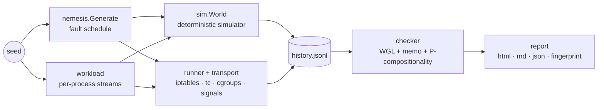

# Strife

**A deterministic chaos testing engine and linearizability checker for distributed systems.**

Strife injects network partitions, latency, packet loss, crashes, process pauses,
cgroup freezes, disk I/O stalls and clock skew into a cluster, records every
client operation, and proves whether the history the cluster produced is
*linearizable*. Every run is driven by a single seed: the fault schedule and the
workload replay identically, and inside the built-in simulator the *entire
execution* replays bit for bit, with a SHA-256 trace hash to prove it.

```
$ strife sim --system raft-unsafe-fsync --faults kill,io-stall --seed 13
system:  raft-unsafe-fsync   seed: 13   nodes: 5   simulated: 10s   events: 108793   wall: 521ms
faults:  6 scheduled (schedule 935d69e22cc1a0f3)
           1.056s →   2.127s  kill [0 2]
           2.668s →   4.069s  io-stall [3]
           4.070s →   6.177s  kill [1]
           4.714s →   5.654s  io-stall [0 1 3]
           6.507s →   8.500s  io-stall [0 1 2 3 4]
           7.878s →   8.500s  kill [0 1 2 3 4]
ops:     4429 (3717 ok, 692 fail, 20 info)   history 66a5f95de89d72c8   trace 50173cb8d89db240
verdict: VIOLATION
  key k0: No linearization places "p29 read k0 → 3" before it returned. After the longest
  valid prefix (854 ops) the model state is 1, and none of the 2 concurrent candidates can
  be applied first to reach a state that explains it.
```

That is a Raft cluster acknowledging writes before `fsync` returns. The disks of
all five nodes stall, the whole cluster loses power, and an acknowledged write
is gone. The bug needs both faults to line up and shows up in about 3–4% of
seeds. That is fine, because ten simulated seconds take about half a second
of wall time, so a laptop explores thousands of seeds over a coffee.

---

## Why

Raft, Paxos, Kafka and Redis Cluster rarely fail on the happy path. They fail
during split brain, latency spikes, a `kill -9` at the wrong moment, a disk
that stops answering, or a clock that jumps. Those windows are narrow and hard
to reproduce, and "the data looked fine" is not a correctness argument. Strife
turns this into an engineering loop:

1. **Inject** faults from a seeded, replayable schedule.
2. **Record** a Jepsen-style history: every invocation and its outcome
   (`ok` / `fail` / `info`, where `info` means the outcome is unknown).
3. **Check** the history against a sequential model with a
   linearizability checker.
4. **Report** a counterexample, a one-line reproduction command, and
   hash-chained artifacts an auditor can verify independently.

## Features

| | |
|---|---|
| **Deterministic simulator** | A FoundationDB-style discrete-event simulator. Network, timers, disks and clocks all draw from one seeded PRNG, so a seed replays the exact execution. `--determinism` runs it twice and compares trace hashes. |
| **Linearizability checker** | Wing & Gong / Lowe search with memoization, per-key P-compositionality run in parallel, and symmetry reduction for indeterminate ops. It is cross-checked against brute force on 3,000 random histories in the test suite. |
| **Live fault injection** | `iptables` partitions in a dedicated `STRIFE` chain, `tc netem` latency and loss, `SIGKILL` with restart, `SIGSTOP`/`SIGCONT`, the cgroup v2 freezer, `io.max` disk stalls, and clock steps. It runs over Docker or SSH. `--dry-run` and `strife plan` show every command before anything is touched. |
| **Automatic shrinking** | `strife shrink` reduces a failing run to its essential faults with delta debugging (ddmin). It then narrows targets, windows, magnitudes, duration and clients, and verifies that every remaining fault is necessary. The result replays bit for bit. |
| **CI native** | `--junit` and `--summary` on every command that reaches a verdict, plus a GitHub Action that builds Strife, posts the digest to the job summary, uploads the reports and fails the job on a violation. |
| **Audit reports** | `report.html`, `report.md`, `report.json`, `history.jsonl` and `schedule.json`, plus a SHA-256 fingerprint over config, schedule, history and trace. |
| **Zero dependencies** | Pure Go standard library. One static binary. |

## Quick start

```sh
go build -o strife ./cmd/strife        # Go 1.23+

strife systems                          # the built-in simulated systems
strife sim --seed 7                     # one simulated run of correct Raft
strife sim --system raft-stale-reads --faults partition --seeds 1..100
open strife-out/raft-stale-reads-seed2/report.html
```

Exploring seeds prints every violating seed and the exact command that
reproduces it. CI can assert the outcome:

```sh
strife sim --system raft --seeds 1..1000 --determinism --expect linearizable
```

### Shrinking a failure

A violating seed usually comes with a dozen faults, and most of them are
noise. `strife shrink` keeps only what the bug needs:

```
$ strife shrink --system raft-unsafe-fsync --faults kill,io-stall --seed 13
shrinking raft-unsafe-fsync seed 13…
  baseline    1 runs  faults 6   10s       clients 10  6 faults, 4429 ops
  duration   18 runs  faults 6   8.94s     clients 10  10s → 8.94s
  faults     27 runs  faults 2   8.94s     clients 10  ddmin: 6 → 2 faults
  targets    46 runs  faults 2   8.94s     clients 10  removed 4 fault targets
  windows    86 runs  faults 2   8.94s     clients 10  total fault time now 1.52s
  round      98 runs  faults 2   8.94s     clients 10  snapped 3 fault boundaries to a coarse grid; 1 timing-critical boundaries kept exact
  ...
  verify    126 runs  faults 2   8.39s     clients 10  1-minimal: every remaining fault [4 5] is necessary
minimal: 6 → 2 faults, 10s → 8.39s, 10 → 10 clients, 4429 → 3931 ops (127 runs, 18s)
         #4   6.5s          → 7.9s          io-stall [3]
         #5   7.877832081s  → 8.1s          kill [0 1 2 3 4]
```

That is the whole story of the bug: node 3's disk stalls, and the cluster
loses power *while* the stall is still going on. The kill time was left
unrounded because snapping it to a coarser grid makes the bug disappear, which
is a finding in its own right.

Across the built-in bugs, 35 of 37 violating seeds (95%) shrink to at most
three faults, and every result is 1-minimal. Typical cost is 80–150
simulations, or 4–12 seconds on four cores (see
[docs/ROADMAP.md](docs/ROADMAP.md#11-strife-shrink-automatic-minimisation--done)).

Shrink from a report (`strife shrink --report strife-out/…/report.json`), or
explore and shrink in one go (`strife sim --seeds 1..500 --shrink`). The
output directory `…-min/` contains the minimal `schedule.json`, a report with
a before/after table, `shrink.json` with every phase, and a reproduction
command. Shrinking is deterministic: the same input always produces the same
minimal scenario, whatever the worker count.

Exit codes: `0` linearizable (or matches `--expect`), `1` violation, `2` usage,
`3` unknown (search budget exhausted), `4` error.

### In CI

```yaml
- uses: kemalhafizh/strife@main
  with:
    command: sim --system raft --seeds 1..500 --determinism --expect linearizable
```

The action builds Strife, runs the command, and does the following:

- writes a JUnit report, with one test case per seed or key and the
  counterexample plus a reproduction command in each failure,
- appends a digest to the job summary,
- uploads every report as an artifact,
- fails the job on a violation.

Outside GitHub, `--junit` and `--summary` work with any CI system. See
[docs/github-action.md](docs/github-action.md) for the inputs, the outputs and
recipes such as bug hunts that must succeed, checking your own histories, and
the Checks tab.

### Checking your own histories

Any system works if you can log operations as JSON lines:

```json
{"process":0,"type":"invoke","f":"write","key":"x","value":3,"time":1000}
{"process":1,"type":"invoke","f":"read","key":"x","time":1200}
{"process":0,"type":"ok","f":"write","key":"x","value":3,"time":1900}
{"process":1,"type":"ok","f":"read","key":"x","value":3,"time":2100}
```

```sh
strife check --history ops.jsonl --model kv --out report/
```

Models: `kv` (independent read/write/compare-and-set registers, checked per
key) and `set` (grow-only set with read-all). `time` is in nanoseconds. A
process that observes `info` must continue under a new process id.

### Testing a real cluster

```sh
cd examples/etcd && docker compose up -d --build
strife plan --config strife.json     # every iptables/tc/pkill command, by time
strife run  --config strife.json     # 2 minutes of chaos, then the verdict
```

Configs are plain JSON (see [`examples/etcd/strife.json`](examples/etcd/strife.json)).
Built-in clients cover etcd v3 (JSON gateway) and Redis/Valkey (RESP, with
compare-and-set done atomically in a Lua script). Adding another database
means implementing one interface:

```go
type Client interface {
    Invoke(ctx context.Context, op history.Op) history.Op // ok | fail | info
    Close() error
}
```

The hard part of a client is classifying errors honestly. Strife's rule: an
error that proves the request never left (connection refused, a 4xx) is `fail`;
a timeout or reset on a write is `info`; a failed read is always `fail`.

## What Strife finds

The simulator ships a compact Raft implementation (`pkg/sim/raft`) with three
switches. Each one re-creates a class of real consensus bug. Detection rates
are measured over 100–200 seeds of a 5-node cluster with the faults listed:

| System | Bug | Faults that expose it | Found |
|---|---|---|---|
| `raft` | none: reads go through the log | all eight kinds | 0 / 800 runs ✅ |
| `raft-stale-reads` | the leader serves reads without confirming leadership | `partition` | ~36% of seeds |
| `raft-lease` | leader leases timed with the wall clock | `clock-skew` + `partition` | ~5% of seeds, 0% without clock faults |
| `raft-unsafe-fsync` | votes and appends acknowledged before `fsync` | `kill` + `io-stall` | ~3.5% of seeds, 0% under partitions |

### Real clusters

The same engine runs against real databases in Docker with real faults
(iptables partitions, signals, tc netem). These runs are part of CI
(`.github/workflows/live.yml`):

| Cluster | Faults | Operations | Verdict |
|---|---|---|---|
| etcd 3.5, 3 nodes ([example](examples/etcd)) | partition, kill, pause | ~16k in 60s | ✅ linearizable |
| Valkey 8, primary + 2 async replicas, reads spread over all nodes ([example](examples/valkey)) | partition, pause | ~19k in 60s | ❌ stale reads from a cut-off replica (expected) |
| Valkey 8, single primary with AOF ([example](examples/valkey)) | `kill -9` | ~10k in 45s | ✅ linearizable: acknowledged writes survive a process crash |

Validating the live path also caught three bugs in Strife itself before
release:

- The etcd example could never start (`ETCD_*` environment variables clash
  with etcd's own flags).
- A second run against the same cluster reported a false violation, because
  it saw values left by the first run. Every run now uses its own key
  namespace.
- `plan --config` ignored `--seed`.

Each bug stays invisible under faults that don't target its mechanism. That is
why the fault mix matters, and why the explorer is cheap enough to run
thousands of seeds.

## Faults

| Kind | Simulator semantics | Live mechanism |
|---|---|---|
| `partition` | drop messages between two sides | `iptables -A STRIFE -s <peer> -j DROP` |
| `latency` | add delay ± jitter to a node's links | `tc qdisc replace … netem delay` |
| `loss` | drop a node's messages with probability *p* | `tc qdisc replace … netem loss` |
| `kill` | crash: volatile state, timers and **un-fsynced writes** lost; reboot later | `pkill -9`, then `db.start` |
| `pause` | process stops, messages and timers queue up | `pkill -STOP` / `-CONT` |
| `freeze` | same as pause | cgroup v2 `cgroup.freeze` |
| `io-stall` | fsyncs block until the stall ends | cgroup v2 `io.max` throttled to ~0 |
| `clock-skew` | local clock rate change + wall-clock jump | `date -s` step (SSH/VM only) |

The scheduler never overlaps faults that share a mechanism (one netem qdisc,
one process state). Different mechanisms do overlap, and that is where the
interesting bugs are. Partitions mostly isolate a minority. Crashes and
stalls sometimes hit a majority or the whole cluster, because losing quorum
may cost availability but never safety.

## Determinism: what is and isn't guaranteed

- **Simulation:** fully deterministic. Same binary + same seed + same flags
  gives the same trace hash. The PRNG is a pinned xoshiro256** (not
  `math/rand`) with a golden-value test, so seeds stay valid across Go
  releases. Sub-streams are derived per actor by label, so adding a node or a
  client doesn't perturb unrelated randomness.
- **Live runs:** the fault schedule and each process's operation sequence are
  deterministic. The interleaving the real cluster and OS choose is not; it
  is recorded in `history.jsonl` and checked as-is. `strife check` re-verifies
  it offline.

## Architecture



```
cmd/strife        CLI: sim, shrink, check, plan, run, systems
internal/rng      pinned, forkable xoshiro256** PRNG
pkg/history       Jepsen-style histories, JSONL, pairing
pkg/model         sequential specs: kv (cas registers), set
pkg/checker       linearizability search and counterexamples
pkg/nemesis       seeded fault schedules → shell commands
pkg/sim           discrete-event world: network, timers, disks, clocks
pkg/sim/raft      reference system under test (+ bug switches)
pkg/explore       simulated runs, seed exploration, determinism checks
pkg/shrink        delta debugging of failing scenarios down to 1-minimal
pkg/transport     docker exec / ssh / dry-run
pkg/client        etcd v3 (JSON gateway) and in-memory reference store
pkg/runner        live test orchestration
pkg/report        audit artifacts and fingerprints
```

## For enterprise and compliance

Strife is designed to back claims a database vendor, bank or fintech has to
defend: *"this cluster stays linearizable under partition, crash and disk
failure."*

- **Reproducible evidence:** every report states the seed and the exact
  command that reproduces it.
- **Tamper-evident artifacts:** the fingerprint covers the config, schedule,
  history and trace. Anyone can recompute it and re-run `strife check` on the
  shipped history to confirm the verdict without trusting the tester.
- **Regression gates:** `--expect linearizable` over a fixed seed range,
  through the GitHub Action or `--junit` on any CI system, turns a chaos
  campaign into a check that fails the build on the first violation. Each
  JUnit suite carries the fingerprint and hashes as properties.

## Roadmap

Done: automatic shrinking (Phase 1.1), and JUnit/summary output with a GitHub
Action (Phase 1.2). Next up: a Redis/Valkey client, checker hardening, then a
per-node `strife-agent` with netlink injection and transactional (Elle-style)
models. See [docs/ROADMAP.md](docs/ROADMAP.md) for
the phased plan, the reasoning behind it, and the claims we will and won't
make.

## Development

```sh
make test        # unit + bug-finding regression tests
make test-short  # race detector, fast
make chaos       # the CI gauntlet: 200 seeds of correct Raft, each bug found, one shrunk
```

## License

Apache 2.0. See [LICENSE](LICENSE).
