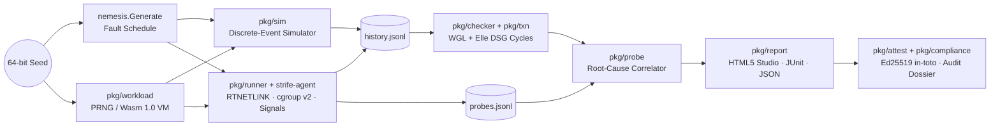

<div align="center">

# Strife

**Deterministic fault injection, linearizability verification, and transactional anomaly detection for distributed systems.**

[](https://github.com/Kemalhafizh/strife/actions/workflows/ci.yml)
[](https://github.com/Kemalhafizh/strife/actions/workflows/live.yml)
[](go.mod)
[-2ea44f)](go.mod)
[](LICENSE)

[Quick Start](#quick-start) · [Interactive Demos](site/index.html) · [Shrinking](#shrinking-failures) · [Models & Checkers](#consistency-models--anomaly-detection) · [Live Clusters & Agent](#live-clusters--strife-agent) · [Benchmarks](docs/BENCHMARKS.md) · [Wasm Workloads](#custom-workloads--wasm-vm) · [Campaigns](#regression-campaigns) · [Attestation & Compliance](#cryptographic-attestation--compliance-dossiers) · [Architecture](#architecture)

</div>

---

Strife drives concurrent workloads against a simulated or live cluster while injecting network partitions, packet delay and loss, process crashes (`SIGKILL`), process pauses (`SIGSTOP`), cgroup v2 freezes, block I/O stalls, and clock skew. It records every client invocation and completion in a Jepsen-style history and proves whether the execution satisfies linearizability or transactional isolation.

Every run is controlled by a 64-bit seed. On live clusters, the seed fixes the fault schedule and each client's operation stream. Inside the built-in discrete-event simulator, the seed fixes the entire execution—network delivery order, timer firings, disk flushes, and clock drift—replaying bit-for-bit with a verifiable SHA-256 trace digest.

```console
$ strife sim --system raft-unsafe-fsync --faults kill,io-stall --seed 13
system:  raft-unsafe-fsync   seed: 13   nodes: 5   simulated: 10s   events: 108793   wall: 521ms
faults:  6 scheduled (schedule 935d69e22cc1a0f3)
           1.056s →   2.127s  kill [0 2]
           2.668s →   4.069s  io-stall [3]
           4.070s →   6.177s  kill [1]
           4.714s →   5.654s  io-stall [0 1 3]
           6.507s →   8.500s  io-stall [0 1 2 3 4]
           7.878s →   8.500s  kill [0 1 2 3 4]
ops:     4429 (3717 ok, 692 fail, 20 info)   history 66a5f95de89d72c8   trace 50173cb8d89db240
verdict: VIOLATION
  key k0: No linearization places "p29 read k0 → 3" before it returned. After the longest
  valid prefix (854 ops) the model state is 1, and none of the 2 concurrent candidates can
  be applied first to reach a state that explains it.
```

In the trace above, a Raft implementation acknowledges log appends before `fsync` completes. When all five disks stall at `6.507s` and the cluster suffers a simultaneous power loss at `7.878s`, a committed write disappears on recovery. Because ten simulated seconds execute in ~520ms of wall time, a single workstation can sweep thousands of fault schedules in a few minutes.

---

## Design Constraints

- **Zero external dependencies.** Both `strife` and `strife-agent` compile from the Go 1.23 standard library alone (`go.mod` has no `require` block). Wire protocols for etcd v3, Redis/Valkey (RESP2), PostgreSQL (v3 protocol with SCRAM-SHA-256 and TLS), MySQL/TiDB (`caching_sha2_password`, TLS), Kafka (Produce v3 / Fetch v4, RecordBatch v2 with CRC-32C), Linux `AF_NETLINK` route sockets, Ed25519 `in-toto` signing, and the WebAssembly 1.0 bytecode interpreter are implemented in-tree.
- **Pinned randomness.** Standard `math/rand` algorithms are not guaranteed to stay identical across Go releases. Strife uses a self-contained `xoshiro256**` PRNG seeded via `SplitMix64` ([`internal/rng`](internal/rng/rng.go)) with per-actor FNV-1a stream forking (`root.Fork("client/3")`), so adding a client or node does not perturb another actor's random draws.
- **Honest verdicts.** When a checker exhausts its step or wall-clock budget without finding either a valid linearization or a proof of impossibility, the verdict is `unknown` (exit code `3`), never a false `linearizable`. A live run in which no operation succeeded is `unknown` too.
- **Measured claims.** Every performance or detection number in this README links to [`docs/BENCHMARKS.md`](docs/BENCHMARKS.md), which gives the command, machine and date that produced it.

---

## Quick Start

Install a release (archives for Linux, macOS and Windows with `SHA256SUMS`, an SPDX SBOM and, when the release key is configured, an in-toto attestation signed with Strife's own Ed25519 signing), use the container images, or build from source:

```sh
# Release binaries: https://github.com/Kemalhafizh/strife/releases
sha256sum -c --ignore-missing SHA256SUMS
strife verify --bundle strife_v0.2.0.intoto.json --key release.pub --release-dir .

# Container images (linux/amd64, linux/arm64)
docker run --rm ghcr.io/kemalhafizh/strife:latest version
docker run --rm ghcr.io/kemalhafizh/strife-agent:latest -h

# From source (Go 1.23+, no CGo, no dependencies)
go build -o strife ./cmd/strife
```

```sh

# List built-in simulated consensus implementations
strife systems

# Run a single seed of correct Raft under all eight fault kinds
strife sim --system raft --seed 7

# Sweep 100 seeds against a Raft variant that serves local leader reads without a quorum round
strife sim --system raft-stale-reads --faults partition --seeds 1..100

# Verify bit-for-bit simulator determinism across 500 seeds in CI
strife sim --system raft --seeds 1..500 --determinism --expect linearizable
```

Each violating run writes a self-contained artifact directory (`strife-out/<system>-seed<N>/`) containing:

| Artifact | Purpose |
| :--- | :--- |
| `report.html` | Offline HTML5/Canvas timeline studio (60fps pan/zoom, anomaly auto-focus, key/process filters, operation inspector, `<noscript>` SVG fallback) |
| `report.md` | Markdown summary suitable for pull requests and `$GITHUB_STEP_SUMMARY` |
| `report.json` | Machine-readable verdict, counterexample witnesses, root-cause findings, and SHA-256 fingerprint |
| `history.jsonl` | Complete operation log (`invoke`, `ok`, `fail`, `info`) with nanosecond timestamps |
| `schedule.json` | Replayable fault schedule (`strife sim --plan schedule.json`) |

---

## Shrinking Failures

A raw violation often spans thousands of operations and half a dozen overlapping faults. `strife shrink` reduces simulated scenarios and recorded histories to a **1-minimal** counterexample (dropping any single remaining fault or operation makes the violation disappear), and live fault schedules to a minimal **candidate** reproducer with a measured reproduction rate.

### 1. Scenario Shrinking (`strife shrink`)

Delta debugging (`ddmin`) runs across nine deterministic passes: test duration, fault set, fault node targets, fault start/end windows, timing grid snapping (`100ms` → `10ms` → `1ms`), fault magnitudes, client count, a second duration pass, and a final 1-minimality check.

```console
$ strife shrink --system raft-unsafe-fsync --faults kill,io-stall --seed 13
shrinking raft-unsafe-fsync seed 13…
  baseline    1 runs  faults 6   10s       clients 10  6 faults, 4429 ops
  duration   18 runs  faults 6   8.94s     clients 10  10s → 8.94s
  faults     27 runs  faults 2   8.94s     clients 10  ddmin: 6 → 2 faults
  targets    46 runs  faults 2   8.94s     clients 10  removed 4 fault targets
  windows    86 runs  faults 2   8.94s     clients 10  total fault time now 1.52s
  round      98 runs  faults 2   8.94s     clients 10  snapped 3 fault boundaries to a coarse grid; 1 timing-critical boundaries kept exact
  verify    126 runs  faults 2   8.39s     clients 10  1-minimal: every remaining fault [4 5] is necessary
minimal: 6 → 2 faults, 10s → 8.39s, 10 → 10 clients, 4429 → 3931 ops (127 runs, 18s)
         #4   6.5s          → 7.9s          io-stall [3]
         #5   7.877832081s  → 8.1s          kill [0 1 2 3 4]
```

Notice `#5`: the `kill` timestamp (`7.877832081s`) was kept unrounded because snapping it to a coarse grid allowed the stalled `fsync` on node 3 to finish before power loss. Across the benchmark corpus in [`docs/ROADMAP.md`](docs/ROADMAP.md), **35 of 37 violating seeds (95%)** reduce to $\le 3$ faults in 80–150 simulator runs.

### 2. History Shrinking (`strife shrink --history`)

For live cluster traces where re-running the cluster is probabilistic, `strife shrink --history` reduces a recorded `history.jsonl` offline:

```console
$ strife shrink --history ops.jsonl --model kv --out strife-out/
shrinking history "ops.jsonl" (2400 ops, model kv)…
  partition    150 ops   isolated violating key "k0"
  diagnose     3 ops     found sound register witness
  ddmin-read   3 ops     eliminated non-essential reads
  ddmin-sound  3 ops     preserved causal write history (isSoundHistory invariant)
  verify       3 ops     1-minimal: dropping any remaining operation removes violation
minimal: 2400 → 3 ops (0.04s)
         #1  call 0.001s   return 0.005s   p1 write k0 → 2
         #2  call 0.006s   return 0.008s   p2 write k0 → 3
         #3  call 0.009s   return 0.012s   p3 read k0 → 2
diagnosis: stale read: p3 read 2 returned at 0.012s, but p2 write 3 completed earlier at 0.008s (1.000ms before read call)
```

> [!IMPORTANT]
> Naive operation dropping can delete the write that produced a value later observed by a read, fabricating a false "unwritten value" violation. `pkg/shrink` enforces an `isSoundHistory` invariant: a write (or `info` write) that supplies the value for a retained read cannot be removed unless the dependent read is removed first.


### 3. Live Schedule Shrinking (`strife shrink --live`)

A real cluster is not deterministic: the same schedule may or may not trigger a bug. `strife shrink --live` re-runs candidate fault schedules on the cluster with delta debugging, counts a candidate as failing if any of `--attempts` runs fails, then re-runs the minimal schedule `--verify` times and reports its reproduction rate. The result is labelled a candidate, never a proof of minimality.

```console
$ strife shrink --live --config examples/postgres/strife-replicas.json --duration 12s --attempts 2 --verify 3
shrinking 1 faults of "postgres-replicas" live (2 attempts per candidate, budget 40 runs)…
  run 1: 1 faults [0] → violation
  run 2: 0 faults [] → violation
  the violation occurs without any fault: the faults are not needed to reproduce it
  verify 1/3: violation
  verify 2/3: violation
  verify 3/3: violation
candidate: 1 → 0 faults, reproduced 3/3 (100%) in 2 live runs, 89.1s
replay: strife run --config examples/postgres/strife-replicas.json --schedule strife-out/postgres-replicas-live-min-…/schedule.json
```

Here the stale reads from PostgreSQL's asynchronous standbys need no fault at all, which is the useful answer: the bug is the topology, not the partition. `strife run --schedule FILE` replays any recorded or shrunk schedule.
---

## Consistency Models & Anomaly Detection

`strife check` verifies any JSONL history against seven built-in models:

```sh
strife check --history ops.jsonl --model kv --out report/
strife check --history txn.jsonl --model txn --isolation snapshot-isolation
```

| Model | Operations | Verification Engine & Complexity |
| :--- | :--- | :--- |
| `kv` | `read`, `write`, `cas` | Wing & Gong / Lowe linearizability search with bitset state memoization, per-key P-compositionality, symmetry reduction, and $O(N \log N)$ stale-read diagnosis (~95k–500k ops/s per core on a single key depending on concurrency; [measured](docs/BENCHMARKS.md#2-checker-throughput)). |
| `set` | `add`, `read` | Grow-only set linearizability + missing-element counterexample witnesses. |
| `queue` | `enqueue`, `dequeue` | FIFO queue linearizability; diagnoses phantom dequeues, FIFO order inversions, and premature empty returns. |
| `counter` | `inc` / `add`, `read` | Shared integer counter linearizability; diagnoses lost increments and overstated reads. |
| `idgen` | `generate` | Unique monotonic/non-colliding ID verification with duplicate witness extraction. |
| `txn` | `txn` (`[r(k), w(k,v), ...]`) | Direct Serialization Graph (DSG) construction (`wr`, `ww`, `rw`, `so`, `ro` edges) + Tarjan SCC shortest-cycle extraction across 6 isolation levels. |
| `append` | `txn` of `append(k, v)` / `r(k) → [v…]` | Elle-style list-append: version orders recovered from reads, `ww`/`wr`/`rw` and real-time edges, lost appends, incompatible orders, duplicates and internal-consistency checks (~40k–57k txns/s; 0 false positives and 99.81 % of invalid histories caught in a brute-force cross-check, [measured](docs/BENCHMARKS.md#3-checker-correctness)). |

<details>
<summary><strong>Transactional Isolation Levels & Adya Anomaly Classification (<code>--model txn</code>)</strong></summary>

<br>

The transactional checker ([`pkg/txn`](pkg/txn/txn.go)) reconstructs item versions from write micro-operations and checks for forbidden phenomena defined by Adya (1999):

- **`G0` (Dirty Write):** Cycle consisting solely of write-write (`ww`) dependency edges.
- **`G1a` (Aborted Read):** A committed transaction reads a value written by an aborted/failed transaction.
- **`G1b` (Intermediate Read):** A committed transaction reads a non-final intermediate write of another transaction.
- **`G1c` (Circular Information Flow):** Directed cycle of `wr` and `ww` edges (forbidden by `read-committed` and stronger).
- **`G2-item` / `G2` (Anti-Dependency Cycles):** Cycles containing one or more read-write (`rw`) anti-dependency edges, such as Write Skew (`T1` reads `x`, `T2` reads `y`, `T1` writes `y`, `T2` writes `x`).
- **`G-realtime` (Real-Time Inversion):** Serialization order contradicts wall-clock completion order (`ro` edge), violating `strict-serializable`.

Supported `--isolation` flags: `read-uncommitted`, `read-committed`, `repeatable-read`, `snapshot-isolation`, `serializable`, `strict-serializable`.

</details>

---

## Live Clusters & `strife-agent`

`strife run` drives a real cluster from a JSON config: the seed fixes the fault schedule and every client's operation stream, the cluster decides the interleaving, and the recorded history is checked exactly like a simulated one.

```sh
strife plan --config strife.json          # the exact commands, without touching anything
strife run  --config strife.json          # run, check, and write report.html / report.json
strife run  --config strife.json --faults none --expect linearizable   # fault-free baseline for CI
```

**Transports** (`transport.type`) decide how fault commands reach the nodes:

| Transport | How | Host faults (`freeze`, `io-stall`) |
| :--- | :--- | :--- |
| `docker` | `docker exec` per command; host commands on the Docker host (optionally `sudo -n`). `"cgroup": "auto"` and `"io_device": "auto"` are discovered at run time. | yes |
| `ssh` | system `ssh` (keys, agents, jump hosts and `known_hosts` as configured), optional `sudo -n` | yes |
| `kubernetes` | `kubectl exec` into pods; `"ip": "auto"` reads pod IPs at run time and `{ip}` endpoints expand per node ([example](examples/kubernetes)) | no: use the agent |
| `agent` | `strife-agent` on each node: persistent HTTP, netlink for netem, direct signals and cgroup v2, token authentication | yes |
| `dry-run` | logs the commands | – |

**Clients** (`db.kind`) are implemented in-tree, with credentials given as `env:NAME` or `file:PATH` references so that secrets never land in configs or reports:

| Target | Protocol and authentication | Workloads | Outcome classification |
| :--- | :--- | :--- | :--- |
| `etcd` | v3 JSON gateway | `kv` (read, write, compare-and-swap), `append` (optimistic transactions guarded by `mod_revision`) | refused or rejected → `fail`; timeout after sending → `info` |
| `redis` / `valkey` | RESP2, `AUTH`, TLS | `kv` (atomic Lua CAS), `append` (Lua script per transaction) | `-READONLY` / `-ERR` → `fail`; I/O error after sending → `info` |
| `postgres` | v3 protocol, SCRAM-SHA-256 / MD5, TLS (`require`, `verify-full`) | `kv`, `append` at any `txn_isolation` | `40001`, `40P01`, `25006`… → `fail`; connection lost after `COMMIT` → `info` |
| `mysql` / `tidb` | `caching_sha2_password` (fast path, RSA or TLS full auth), `mysql_native_password`, TLS, `init_sql` | `kv`, `append` | deadlock / lock timeout / TiDB write conflict → `fail`; lost after `COMMIT` → `info` |
| `kafka` | ApiVersions, Metadata v4, Produce v3 (`acks=all`), Fetch v4, RecordBatch v2 | `append` (each key a single-partition topic, read from offset 0) | rejected before append (not leader, not enough replicas…) → `fail`; request timeout or lost connection after sending → `info` |

`workload.model` picks `kv` (linearizability) or `append` (list-append transactions checked at `workload.isolation`, from read-uncommitted to strict-serializable). `db.txn_isolation` sets the level the database runs at, so you can, for example, run PostgreSQL at REPEATABLE READ and hold it to serializability.

> [!NOTE]
> Whenever a client records `info` (for example, a TCP connection reset after sending a `SET` or `COMMIT`), the operation may still take effect on the server at an arbitrary point in the future. Following Jepsen's process invariant, the worker closes the socket and increments its logical `process` ID (`process += concurrency`) before issuing another operation.

### Injection Latency: `docker exec` vs `strife-agent`

`strife bench inject` measures how late each fault takes effect after its planned instant. On a GitHub-hosted runner against a 3-node etcd cluster (50 transitions per row, [full table and method](docs/BENCHMARKS.md#1-fault-injection-latency)):

| Fault | `docker exec` P50 / P95 | `strife-agent` P50 / P95 | Inside the agent (P50) |
| :--- | ---: | ---: | ---: |
| `pause` (SIGSTOP) | 43.7 / 45.1 ms | **1.36 / 1.90 ms** | 372 µs |
| `kill` (SIGKILL) | 44.4 / 46.1 ms | **1.58 / 1.99 ms** | 495 µs |
| `partition` (iptables) | 57.9 / 61.3 ms | **4.02 / 4.29 ms** | 2.61 ms |
| `latency` (netem) | 42.8 / 44.1 ms | 48.1 / 59.5 ms ¹ | **159 µs** |

¹ The agent's reply crosses the interface it just slowed down, so the confirmation arrives late; the qdisc itself was installed 159 µs after the request reached the agent. Partitions still shell out to `iptables` inside the agent; signals, netem and cgroup writes are direct syscalls.

### Server-Side Diagnostic Probes & Root-Cause Correlation

While client histories prove *whether* a consistency violation occurred, `strife-agent` also exposes `GET /probes` ([`pkg/probe`](pkg/probe/probe.go)) to explain *why* it occurred without instrumenting application code:

- **Storage `fsync` canary:** Measures active `fsync` latency stalls and `EIO`/`ENOSPC` errors on the database volume.
- **Linux Pressure Stall Information (PSI):** Reads `/proc/pressure/io` and `/proc/pressure/cpu` microsecond stall deltas (`io_pressure`, `cpu_pressure`).
- **cgroup v2 OOM & Process Signals:** Tracks `oom_kill` events in `memory.events` and process signals (`SIGKILL`, `SIGSTOP`, `CGROUP_FREEZE`).
- **Clock Jumps:** Detects non-monotonic wall-clock leaps (`clock_jump`).

During `strife run` (or offline via `strife check --history ops.jsonl --probes probes.jsonl`), the correlator ([`pkg/probe/correlate.go`](pkg/probe/correlate.go)) matches counterexample windows and indeterminate `info` writes against overlapping node telemetry, attaching ranked root-cause attributions (`high` / `medium` / `low` confidence) directly to `report.json` and `report.md`.

> [!WARNING]
> Strife refuses `clock-skew` faults when `transport.type` is `"docker"`. Containers share the host kernel clock (`CLOCK_REALTIME`), so stepping the clock inside a container would skew the Docker host itself. Use the simulator or VM-isolated nodes (`ssh` / `agent`) for clock-skew testing.

---

## Custom Workloads & Wasm VM

Strife includes a zero-dependency, fuel-metered **WebAssembly 1.0 (MVP) bytecode interpreter** ([`pkg/workload/wasm.go`](pkg/workload/wasm.go)) and a declarative-to-Wasm compiler ([`pkg/workload/workload.go`](pkg/workload/workload.go)). Custom workloads can be supplied as `.wasm` binaries, `.json` specifications, or built-in `preset:<name>` profiles.

```sh
# List built-in workload presets and their compiled Wasm sizes
strife workload --list

# Compile a hotspot CAS preset (or custom .json spec) into a standalone .wasm binary
strife workload --compile preset:cas-hotspot --out cas-hotspot.wasm

# Validate a .wasm plugin, print its SHA-256 digest, and preview deterministic ops
strife workload --inspect cas-hotspot.wasm --seed 42 --sample 6

# Run a deterministic simulation or multi-seed campaign with the .wasm workload
strife sim --system raft --workload cas-hotspot.wasm --seed 7 --determinism
strife campaign --system raft --workload preset:read-heavy --seeds 1..100
```

| Built-in Preset | Distribution | Operation Mix | Primary Stress Target |
| :--- | :--- | :--- | :--- |
| `preset:kv-balanced` | `uniform` | 50% `read`, 30% `write`, 20% `cas` | General register linearizability |
| `preset:read-heavy` | `uniform` | 85% `read`, 10% `write`, 5% `cas` | Stale leader-lease reads (YCSB-B) |
| `preset:write-heavy` | `uniform` | 20% `read`, 60% `write`, 20% `cas` | Log replication & `fsync` durability (YCSB-A) |
| `preset:cas-hotspot` | `hotspot` (80% on 20% keys) | 25% `read`, 25% `write`, 50% `cas` | Lock contention & compare-and-swap races |
| `preset:sequential-scan` | `sequential` | 70% `read`, 30% `write` | Deterministic key-range traversal |
| `preset:si-write-skew` | `hotspot` (85% on 25% keys) | 100% multi-key `txn` (`r, r, w`) | Snapshot Isolation write-skew (`G2`) |

<details>
<summary><strong>WebAssembly 1.0 Plugin ABI & Sandbox Guarantees</strong></summary>

<br>

A `.wasm` workload module exports a single pure function:

```wat
(func (export "next_op")
  (param $process i32)   ;; logical client process ID
  (param $step i32)      ;; monotonic per-process step counter (0, 1, 2, ...)
  (param $rand_u64 i64)  ;; 64-bit draw from the process's forked xoshiro256** stream
  (param $keys i32)      ;; configured key domain size
  (param $values i32)    ;; configured value domain size
  (result i64))          ;; bit-packed operation descriptor
```

**Return Value Bit Layout (`uint64`):**
- **Bits `0..7`:** Operation code (`0`=read, `1`=write, `2`=cas, `3`=add, `4`=enqueue, `5`=dequeue, `6`=inc, `7`=generate, `8`=txn).
- **Bits `8..23`:** Key index (`uint16`, taken modulo `keys`).
- **Bits `24..43`:** Primary value (`20-bit` unsigned integer, taken modulo `values`).
- **Bits `44..63`:** Auxiliary / expected CAS value (`20-bit` unsigned integer, taken modulo `values`).

**Sandbox Guarantees:**
- Every invocation runs in an isolated stack/memory frame with a default instruction budget of `10,000` instructions (`DefaultMaxFuel`) and a call-stack depth limit of `32`. Infinite loops trap immediately without hanging the simulator.
- Linear memory is capped at 16 pages (`1 MiB`) with bounds-checked loads and stores.

</details>

---

## Regression Campaigns

`strife campaign` executes parallel seed sweeps, writes an interactive regression dashboard (`campaign.html`), and compares results against a committed baseline manifest (`baseline.json`) to catch regressions across commits:

```sh
# 1. Establish a baseline on main
strife campaign --system raft --seeds 1..200 --commit $(git rev-parse --short HEAD) \
  --save-baseline baseline.json --out strife-campaign

# 2. Gate a pull request against regressions (automatically replays any previously failing seeds)
strife campaign --system raft --seeds 1..200 --baseline baseline.json \
  --expect no-regression --junit junit.xml --summary "$GITHUB_STEP_SUMMARY"
```

The diff engine ([`pkg/campaign/diff.go`](pkg/campaign/diff.go)) classifies every seed into `regressed` (`linearizable → violation`), `fixed` (`violation → linearizable`), `persistent_failure`, `new_failure`, or `trace_drift` (verdict unchanged, but simulator `trace_hash` diverged).

---

## Cryptographic Attestation & Compliance Dossiers

For regulated environments (banking, fintech, and storage vendors), Strife provides offline Ed25519 signing ([`pkg/attest`](pkg/attest/attest.go)) and automated technical control mapping ([`pkg/compliance`](pkg/compliance/compliance.go)).

```sh
# 1. Generate an Ed25519 keypair (PKCS#8 private .key mode 0600, PKIX public .pub)
strife keygen --out audit-key

# 2. Sign a test report into an in-toto v0.1 Statement bundle
strife sign --report strife-out/raft-seed7/report.json \
  --key audit-key.key --signer "release-pipeline" --out strife-out/raft-seed7/bundle.json

# 3. Verify the signature, recomputed report fingerprint, and raw history.jsonl digest
strife verify --bundle strife-out/raft-seed7/bundle.json \
  --key audit-key.pub --history strife-out/raft-seed7/history.jsonl

# 4. Generate a regulatory compliance dossier (JSON, Markdown, and print-ready HTML)
strife compliance --report strife-out/raft-seed7/report.json \
  --bundle strife-out/raft-seed7/bundle.json --key audit-key.pub \
  --frameworks dora,soc2,iso27001,bi-ojk --out strife-compliance --strict
```

### Supported Regulatory Frameworks

| Framework | Flag | Strife checks and the provisions they support |
| :--- | :--- | :--- |
| **EU DORA** (Regulation (EU) 2022/2554) | `dora` | `dora.resilience-testing` (Art. 24–25), `dora.data-integrity` (Art. 9(3)(b)–(c)), `dora.recovery` (Art. 11–12) |
| **AICPA SOC 2** (Trust Services Criteria) | `soc2` | `soc2.processing-integrity` (PI1.3–PI1.4), `soc2.recovery` (A1.2–A1.3), `soc2.test-evidence` (CC4.1) |
| **ISO/IEC 27001:2022** | `iso27001` | `iso27001.redundancy` (Annex A 8.13–8.14), `iso27001.clock-sync` (8.17), `iso27001.security-testing` (8.29) |
| **OJK** (Indonesia) | `bi-ojk` | `bi-ojk.pemulihan-bencana`, `bi-ojk.integritas-data`, `bi-ojk.jejak-audit` (POJK No. 11/POJK.03/2022; SEOJK No. 29/SEOJK.03/2022) |

Control IDs are Strife's own labels for its technical checks, not identifiers issued by a regulator or standard body; every control in a dossier cites the provision it supports. A dossier is technical evidence for an auditor, not a certification or a legal opinion.

Each control is evaluated strictly from empirical evidence (`PASS`, `PARTIAL` when fault coverage or cryptographic signing is incomplete, or `FAIL`). Every dossier includes an explicit **Methodology & Scope Boundaries** disclosure detailing what was tested, which fault classes were omitted, and the difference between deterministic simulation and live cluster execution.

---

## Empirical Validation

Everything below is reproduced by a command in [`docs/BENCHMARKS.md`](docs/BENCHMARKS.md).

**Simulated bug corpus** (200 seeds each, 5 nodes, 10 simulated seconds):

| System | Bug | Required faults | Violating seeds |
| :--- | :--- | :--- | :--- |
| `raft` | none | all 8 fault kinds | **0 / 200** |
| `raft-stale-reads` | deposed leader serves local reads | `partition` | **75 / 200** |
| `raft-lease` | lease timed with the local wall clock | `clock-skew` + `partition` | **10 / 200** (0 without `clock-skew`) |
| `raft-unsafe-fsync` | votes and entries acked before `fsync` | `kill` + `io-stall` | **7 / 200** (0 under `partition` alone) |

**Live clusters in CI** ([`.github/workflows/live.yml`](.github/workflows/live.yml), every push). Correct configurations must pass and known-weak ones must be caught:

| System | Faults | Verdict |
| :--- | :--- | :--- |
| etcd 3.5 (Docker, via `strife-agent`, and on Kubernetes in kind) | partition, kill, pause, latency, loss, freeze, io-stall | linearizable; transactions strictly serializable |
| PostgreSQL 17, SERIALIZABLE primary | kill -9, pause | strictly serializable |
| PostgreSQL 17, REPEATABLE READ | kill -9, pause | snapshot isolation holds; **write skew (G2)** caught at serializable |
| PostgreSQL 17, async standbys | partition | **stale reads** caught; `shrink --live` shows no fault is needed |
| MySQL 8.4 | freeze | SERIALIZABLE strictly serializable; **REPEATABLE READ violates snapshot isolation** |
| TiDB 8.5 | freeze | optimistic mode satisfies snapshot isolation; **pessimistic mode does not** |
| Valkey 8 | partition, pause, kill -9 | **stale replica reads** caught; single primary with `appendfsync always` linearizable |
| Kafka 3.9.1 and 4.1.0 (KRaft) | partition, kill -9, pause | no acknowledged record lost or reordered; stale reads after leader changes reported |

**Checker correctness:** in brute-force cross-checks the list-append checker flagged none of 150,030 valid histories and caught 99.81 % of 49,970 invalid ones; the register-transaction checker flagged none of 40,000. Every parser of untrusted bytes (wire protocols, JSONL, Wasm) is fuzzed in CI.

---

## Architecture



```text
cmd/strife        CLI: sim, campaign, shrink, check, plan, run, bench, workload, keygen, sign, verify, compliance, systems, version
cmd/strife-agent  Per-node daemon: Linux AF_NETLINK netem, direct signals, cgroup v2, /probes telemetry, token auth
internal/rng      Pinned, forkable xoshiro256** PRNG seeded with SplitMix64
internal/stats    Nearest-rank percentiles and latency summaries
internal/secret   env:/file: secret references and redaction
internal/jsonschema  JSON Schema generation, validation and compatibility checks for schemas/
pkg/history       Jepsen-style operation histories, JSONL codec, SHA-256 hashing
pkg/model         Sequential specifications: kv, set, queue, counter, idgen, txn, append
pkg/txn           Dependency-graph checkers: register txns and Elle-style list-append (G0, G1a/b/c, G-single, G2, G-realtime, lost appends)
pkg/checker       Wing & Gong / Lowe linearizability solver, P-compositionality, witness diagnosis
pkg/nemesis       Deterministic fault schedule generator & command lowering
pkg/workload      Declarative workload compiler, presets, and fuel-metered WebAssembly 1.0 stack machine
pkg/sim           Discrete-event simulation world (network, timers, disk flushes, local clocks)
pkg/sim/raft      Reference Raft consensus implementation with configurable safety bugs
pkg/explore       Parallel seed exploration & bit-for-bit determinism verification
pkg/campaign      Multi-seed campaign runner, baseline regression tracker, HTML heatmap dashboard
pkg/shrink        1-minimal scenario & history delta debugging; live schedule shrinking with reproduction rates
pkg/transport     Execution transports: docker exec, ssh, kubectl exec, strife-agent HTTP/Unix socket, dry-run
pkg/agent         Agent HTTP server, Linux RTNETLINK encoder, cgroup v2 controller, apply-latency collector
pkg/probe         Server-side telemetry collector (fsync canary, Linux PSI, OOM, clock jumps) & correlator
pkg/client        Zero-dependency clients: etcd v3, Redis/Valkey, PostgreSQL (SCRAM, TLS), Kafka, MySQL/TiDB (caching_sha2, TLS)
pkg/runner        Live cluster test orchestrator, fault injector & per-run namespace isolation
pkg/bench         Fault-injection latency benchmark (strife bench inject)
pkg/report        Interactive HTML5/Canvas timeline studio, Markdown/JUnit exporters, fingerprints
pkg/attest        in-toto v0.1 statements, Ed25519 signing/verification, release attestations
pkg/compliance    Regulatory control evaluator (EU DORA, SOC 2, ISO 27001, OJK) with citations & HTML/MD/JSON dossiers
schemas/          Versioned JSON Schemas for report.json, history.jsonl and dossier.json
site/             Interactive product showcase & standalone HTML5 demos (timeline, campaign, dossier)
```

<details>
<summary><strong>CLI Reference & Exit Codes</strong></summary>

<br>

| Command | Description |
| :--- | :--- |
| `strife sim [flags]` | Run a single seed or sweep `--seeds 1..N` in the deterministic simulator (`--determinism`, `--shrink`, `--workload`) |
| `strife campaign [flags]` | Run a multi-seed campaign, emit `campaign.html`, and diff against `--baseline` (`--expect no-regression`) |
| `strife shrink [flags]` | Minimize a failing simulation (`--seed` / `--report`) or recorded trace (`--history FILE`) to 1-minimality, or a live schedule (`--live --config`) to a candidate reproducer |
| `strife check [flags]` | Verify a recorded `history.jsonl` against `--model` (`kv`, `set`, `queue`, `counter`, `idgen`, `txn`, `append`) and optional `--probes` |
| `strife plan [flags]` | Print the seeded fault schedule and exact host/container commands without executing them |
| `strife run [flags]` | Execute a live chaos test defined by `strife.json` (`--dry-run`, `--faults`, `--expect`, `--schedule`) |
| `strife bench inject [flags]` | Measure fault-injection latency per transport and fault kind (`--transports docker,agent`, `--json`, `--markdown`) |
| `strife workload [flags]` | List presets (`--list`), compile specs to `.wasm` (`--compile --out`), or inspect `.wasm` plugins (`--inspect`) |
| `strife keygen [flags]` | Generate an Ed25519 signing keypair (`<prefix>.key` and `<prefix>.pub`) |
| `strife sign [flags]` | Sign a `report.json` into an `in-toto` v0.1 attestation bundle, or release artifacts (`--release`) |
| `strife verify [flags]` | Verify a signed `bundle.json` (and optional `history.jsonl`) or a release directory (`--release-dir`) against an Ed25519 public key |
| `strife compliance [flags]` | Evaluate a report/campaign and attestation bundle against `dora,soc2,iso27001,bi-ojk` |
| `strife version` | Print the version stamped at build time |
| `strife systems` | List built-in simulated systems and the fault combinations that expose their bugs |

**Exit Codes:**
- `0` — `linearizable` (or matches `--expect` / all compliance controls pass)
- `1` — `violation` (or regression / compliance failure / signature mismatch)
- `2` — invalid CLI usage or configuration error
- `3` — `unknown` (checker search budget or timeout reached without a conclusive verdict)
- `4` — runtime or transport execution error

</details>

---

## CI Integration

Use the composite GitHub Action (see [`docs/github-action.md`](docs/github-action.md) for inputs, outputs, and GitLab/Jenkins recipes):

```yaml
- uses: kemalhafizh/strife@v0.2.0   # a release tag downloads the checksum-verified binary
  with:
    command: sim --system raft --seeds 1..500 --determinism --expect linearizable
```

Reports follow versioned JSON Schemas in [`schemas/`](schemas) (`report.v1.json`, `history.v1.json`, `dossier.v1.json`); CI rejects any change that would break them.

## Development

```sh
make test        # Unit tests + bug-finding regression suite
make test-short  # Fast unit tests with the race detector (-race)
make chaos       # Full CI gauntlet: 200 seeds of Raft + bug discovery + shrinking verification
```

See [`docs/ROADMAP.md`](docs/ROADMAP.md) for architectural decisions, benchmark methodology, and roadmap history.

## License

Apache License 2.0. See [`LICENSE`](LICENSE).
